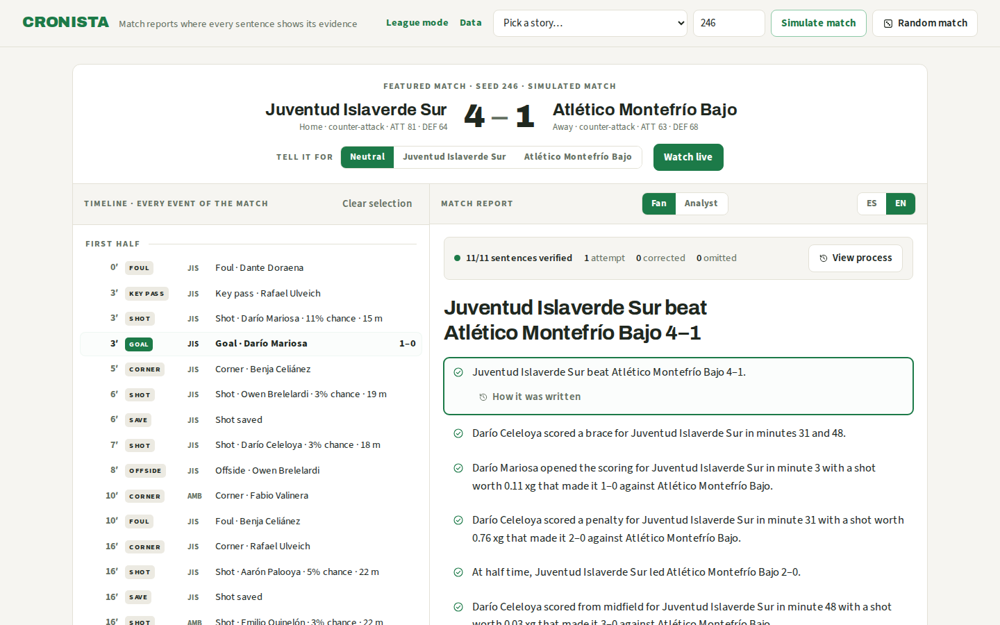
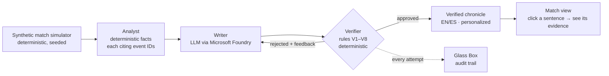
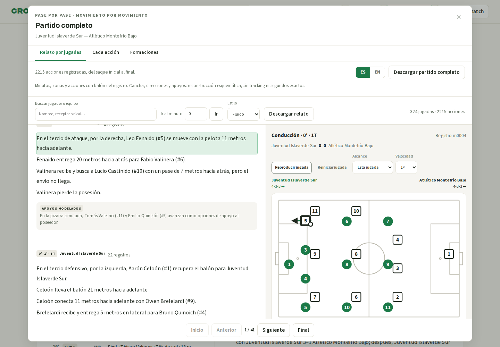

# CRONISTA

**AI match chronicles with a clickable evidence trail.**

[Try the live demo](https://cronista.mangoocean-cf77f6f8.eastus2.azurecontainerapps.io) · [One-minute walkthrough](docs/entrega/judges-guide.md)



Hosted on Azure Container Apps with real Azure OpenAI output: the first public
report passed with 11 sentence pairs on its first attempt, with zero omissions.
[Public browser checks](docs/evidencia/smoke-browser-public.json).
[Video preview](docs/entrega/demo-en-borrador.mp4): a local recording, 1:50,
English captions, no audio. A separate [25-second playback clip](docs/entrega/reproduccion-en-borrador.webm)
shows the current public app in English, without audio. Both are review drafts;
final video publication is pending.

An AI recap can sound convincing even when a detail lacks supporting evidence.
Readers need a way to inspect its claims.
CRONISTA generates bilingual (EN/ES) football match chronicles from synthetic
match events. **Every sentence in the AI recap passes the defined V1–V8 checks**:
a deterministic Verifier checks structure, citations, numbers, names and
maintained claim patterns before publication. The Glass Box lets you inspect
the evidence and the drafts it rejected. These checks do not prove every
possible assertion in unrestricted prose; see the [review evidence](docs/evidencia/verificador-2026-10-10.md).

Built for the **Inside the Game** hackathon (Microsoft × Premier League):
explainable match intelligence, real-time narratives, and automated match recaps,
flexible enough for fans in any market.

## Hackathon documentation

- [Official event portal — Microsoft Innovation Studio](https://innovationstudio.microsoft.com/hackathons/insidethegamedeveloperhackathon)
- [Official rules](https://github.com/microsoft/insidethegamehackathon/blob/main/OFFICIAL%20RULES.md)
- [Code of conduct](https://github.com/microsoft/insidethegamehackathon/blob/main/CODE%20OF%20CONDUCT.md)
- [Microsoft repository license](https://github.com/microsoft/insidethegamehackathon/blob/main/LICENSE.md)
- [Resource playlists](https://github.com/microsoft/insidethegamehackathon/blob/main/RESOURCE%20PLAYLISTS.md)
- [Microsoft repository security policy](https://github.com/microsoft/insidethegamehackathon/blob/main/SECURITY.md)

[Submission preparation](docs/hackathon.md) · [Project review — October 10, 2026](docs/revision-2026-10-10.md)

## Architecture



[Football tactics and movement proposal](docs/disenos/033-tactica-y-movimiento.md)
(Spanish): 25 primary sources, seven formations, seven tactical profiles and
14 coordinated movement patterns, with a [proposed JSON catalog](docs/tactica/catalogo-propuesto.v1.json)
and phased integration plan. This is research and design; the application does
not consume this catalog directly, and movement parameters require calibration.
The experimental lab below adapts its first three formation profiles.

## Experimental team agents lab

Open **Team agents lab** in the app to inspect 22 players, team plans, individual
orders and engine events on one shared pitch. Programmed scenarios and playback
make no model calls. A recorded real Azure OpenAI example is included: two
independent controllers using the same GPT-6.1 Sol deployment, four valid
decisions, no fallbacks. Different-model comparisons remain pending.

The CLI runs two LLM controllers with simultaneous observations, bounded
requests, cancellation and programmed fallback:

```bash
npm run arena -- --modo llm --segundos 10 --intervalo 5 --salida .cache/arena-modelos.json
npm run arena -- --reproducir .cache/arena-modelos.json
```

[Setup, configuration and limitations](docs/arena.md). This is a short 2D open-play
prototype with simplified restarts and uncalibrated movement. Existing reports
and their historical evaluations retain their original simulator.

## The multi-agent system (Best Multi-Agent System category)

| Category requirement | How CRONISTA meets it |
|---|---|
| Distinct roles | Simulator (data), Analyst (deterministic facts), Writer (LLM prose), Verifier (deterministic judge) — no role overlaps |
| Shared state | The event log and the fact list are the single source of truth every agent reads and cites |
| Effective handoffs | Facts carry event citations; sentences carry fact citations; the audit trail records every handoff |
| Recover from failures | Rejected sentences trigger retries with rule-specific feedback (max 2); unrecoverable output falls back to a visibly labeled report from the Analyst’s templates |
| Outcome compared with a single agent | Real GPT-6.1 Sol evaluation, 20 fixed matches: 0/163 baseline sentence pairs flagged by the Verifier; 0/167 published pipeline pairs flagged. This run did not demonstrate a reduction in findings. [Recorded evaluation](docs/evidencia/eval-gpt-6.1-sol/informe.txt) |

The baseline and pipeline use the same rules-aware prompt and verified facts,
with independent model generations. Each counted unit contains ES and EN text.
The pipeline retried one factually supported sentence (seed 7): V8 did not resolve
its implicit subject after a colon. This is a **false positive**, not a caught
hallucination. That specific false positive has since been corrected. An
[offline recheck of the recorded responses](docs/evidencia/eval-gpt-6.1-sol/revalidacion-v8.json)
accepts all 20 first pipeline drafts, including seed 7, without new model calls.
This recheck is not a new real-model run. Findings measure the product's maintained
rules, rather than an independent human assessment of factual accuracy.
[Audit and actual token usage](docs/evidencia/eval-gpt-6.1-sol/auditoria.json).

To reproduce the recorded results without credentials or network calls:

```bash
node --import tsx docs/evidencia/eval-gpt-6.1-sol/reproducir.mjs
```

Fresh model generations can differ. The historical replay uses the archived
original evaluator and checks its hash; it preserves the original result after
the V8 correction. `npm run eval` performs a new real-model run when configured.

The orchestration is implemented in TypeScript. The Writer uses an LLM; the
Analyst and Verifier are deterministic stages. Microsoft Agent Framework,
MCP and A2A are not implemented in this repository.

## How verification works

One sentence narrates exactly **one fact**. The Verifier checks, per sentence:
schema (V1), citations exist (V2), every number — digits or words — appears in
the narrated fact (V3), every proper name belongs to it (V4), every required
fact is narrated, not just cited (V5), negations must be backed by a recorded
zero (V7), and strong claims are allowed only when the fact's data pays for
them (V8) — "dominated" needs the possession, "match-winner" needs the score
sequence, "wilted in the heat" needs the measured second-half drop in **that**
match, "bicycle kick" needs the recorded shot type, and an own goal forbids
crediting "scored" to the rival. ES and EN must agree on every figure (V6).
Red-team lie batteries crafted across five adversarial audit rounds ship as
permanent tests; all are rejected.

## A living fictional world

Everything runs on a fully synthetic world — 8 fictional countries with
climates, one league each (10 teams, double round-robin), all navigable:

- **Visible loading feedback**: preparing a match, changing perspective, opening
  league pages, loading commentary or 3D, starting a replay and downloading the
  sample all show a pending state. Simulation controls prevent duplicate requests;
  replay and sample downloads offer retries. Indicators respect reduced motion.
  [Published loading and recovery checks](docs/evidencia/estados-carga.json).
- **Connected commentary and the complete log**: follow each possession in
  English or Spanish, with shirt numbers, passes, distances and outcomes.
  Select a sentence to see the action on the pitch, or open a goal's full build-up.
  Choose **Flowing / Detailed** commentary. Flowing text connects a completed pass
  to its receiver's next action and introduces shirt numbers before using short,
  unambiguous names. **Play sequence** moves the player markers and ball through
  the same schematic action; pause, restart, change speed or follow the whole
  match. Playback starts paused, respects reduced motion and stops when hidden.
  Its reading pace is illustrative, and cuts can occur between recorded zones.
  **Every action** keeps every recorded pass, carry, duel and match event in order.
  Search players and receivers, jump to a minute and download the entire text.
  The commentary uses deterministic templates with event IDs and makes no extra
  model calls. The pitch, directions and off-ball support runs are labelled
  schematic reconstructions; recorded locations have zone precision, with no
  observed tracking or exact seconds.
  **Formations** shows both starting line-ups and the active players after
  substitutions and sendings-off, with their actual names, roles and shirt numbers.
  [Published flowing commentary and playback checks](docs/evidencia/relato-reproduccion.json).
- **League mode**: standings, matchdays, top scorers; every result opens the
  full report.
- **Conditions that really bite**: heat slows the second half, rain degrades
  passing, synthetic turf speeds up shots, tall grass bogs down the visitors —
  each effect statistically proven (A/B over 500 matches), and the chronicle
  may only mention an effect **measured in that match**.
- **Consequences across matchdays**: red cards suspend, injuries sideline for
  1–4 matchdays, lineups adjust — and every player accrues a season rating
  that unfolds, click by click, into the per-match ratings that produced it.
- **Goals with soul**: headers, one-on-ones, chips, bicycle kicks (0.25% of
  goals), halfway-line screamers (0.14%), own goals under the FIFA rule — each
  with hard coherence constraints on distance, speed, and origin.
- **Live replays** of any match, minute by minute, with a no-clairvoyance
  guarantee: the ticker at minute M cites nothing from the future.
- **The goal as a diorama**: every goal card offers a 2D tactics board and a
  3D scene — procedural, lazy-loaded (133 KB), where **only the ball moves**,
  because only the ball's trajectory is recorded data. Player pieces stay
  still in their recorded zones. The label says so, always.



## Microsoft technologies

<!-- Map each to its file; list ONLY what is actually used. -->
| Technology | Where |
|---|---|
| Microsoft Foundry / Azure OpenAI (GPT-6.1 Sol, tested live) | `src/lib/llm-azure-openai.ts` |
| Azure Container Apps Consumption (public HTTPS demo) | `infra/app.bicep` |
| Azure Container Registry / managed identity (remote build and image pull) | `infra/registry.bicep`, `scripts/deploy-azure.mjs` |
| GitHub Actions (unit/statistical tests + Playwright workflow) | `.github/workflows/ci.yml` |
| GitHub CLI | repo management |

[One-minute walkthrough for judges](docs/entrega/judges-guide.md)

## Quick start (no API key needed)

```bash
npm ci
npm run dev        # offline stub mode → http://localhost:3000
```

The stub writer is deterministic, so the full pipeline — simulator, analyst,
verifier, Glass Box, league mode, live replay, 3D board — runs offline. Real
prose: copy `.env.example` to a local `.env`, then set `CRONISTA_LLM=azure-openai`,
the Azure variables and `AZURE_OPENAI_REASONING_EFFORT=low` there. The optional Claude
adapter uses `CRONISTA_LLM=foundry`; its deployment is currently blocked by
Marketplace subscription eligibility. The public demo uses Azure OpenAI.
The [Azure deployment runbook](docs/entrega/despliegue.md) includes a Docker image,
Bicep templates, and a command that builds remotely in ACR without local Docker.

```bash
npm test           # 1,429 unit/invariant/oracle/lie-battery tests
npm run test:stats # 55 checks: N=1000 matches + A/B condition proofs
npm run e2e        # 62 browser journeys against the production standalone build
npm run test:deploy # deployment context and artifact credential checks
```

## Synthetic data

No real match footage or data is used anywhere. The simulator generates
football-realistic matches (seeded, byte-for-byte reproducible): ~2.9 goals
per match, the stronger team wins 63%, red cards in 12.5%, ~25% draws (Premier
League: ~24%), three distinguishable play styles, and **~2,100 micro-events
per match** (passes with 79.6% completion, dribbles, duels) with causal
continuity — the receiver of a pass is the next actor. Realism is enforced by
a statistical test suite over 1,000 matches plus per-condition A/B proofs.
All countries, leagues, teams and players are fictional.

## Responsible AI & known limitations

- **100% synthetic data; no real people, clubs, or trademarks.**
- **Every sentence in the AI recap passes V1–V8.** When a sentence fails those checks
  after retries, it is omitted or the chronicle falls back to a template-based
  report — visibly labeled. Assertions outside the maintained rules can pass;
  [a reproduced example](docs/evidencia/verificador-2026-10-10.md) demonstrates
  that limit. Independent semantic evaluation remains needed.
- **Causal honesty, not just factual honesty.** "They never settled on the tall
  grass" is blocked when it also rained — the rain, not the grass, could
  explain the drop. The same losses are never narrated twice under two names.
- **Honest limits:** verification of numbers, names, structure and listed strong
  claims is deterministic and tested; a novel rhetorical figure outside the
  maintained lexicon could pass. The Glass Box makes every AI recap sentence
  inspectable, and the lie battery grows with every red-team round.
- Player ratings are computed from events with a clickable breakdown — auditable
  arithmetic, not AI opinion. Season ratings are the audited per-match ratings,
  averaged, with the full list one click away.

Validated on 17 October 2026 (America/Guatemala): typecheck, 1,429 unit tests,
55 statistical checks, 62 browser journeys and two deployment packaging checks.
[CI passed for the published application](https://github.com/calusaca/cronista/actions/runs/39082924408),
including Bicep compilation, the Docker image, an HTTP smoke, non-root execution
and writable cache. The [flowing commentary and playback Azure release](docs/evidencia/relato-reproduccion.json)
passed separate [HTTP checks with the real provider](docs/evidencia/smoke-web-reproduccion.json)
and a public browser walkthrough: player and ball movement, stable pause, linked
sentence, style selection, complete TXT download with the same 2,215 ordered IDs
even while filtered, goal build-up, both languages, dark mode and a 360px viewport.
No JavaScript errors or extra API requests occurred after opening the detail.

The [six-transcript analysis](docs/evidencia/analisis-transcripts.json), including
two radio-style examples, informed the narrative design without importing real
match data into the simulator. In seed 246, the flowing variant uses 27,342 words
in ES versus 34,194 in the detailed variant, and 27,041 versus 31,565 in EN. These
are descriptive word counts over the same action clauses, not measured gains in
reader comprehension or predicted hackathon scores.

The CI browser suite uses a labeled rehearsal fixture. The public demo loads a
GPT-6.1 Sol recap; full commentary and schematic playback run deterministically
on the client. A fresh report in this release took about 19 seconds; the replica's
cache is ephemeral, so scale-to-zero can require a new generation.
