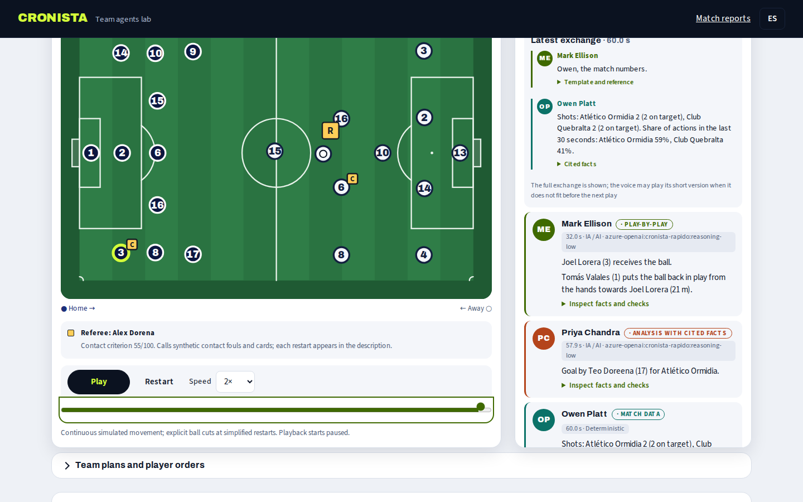
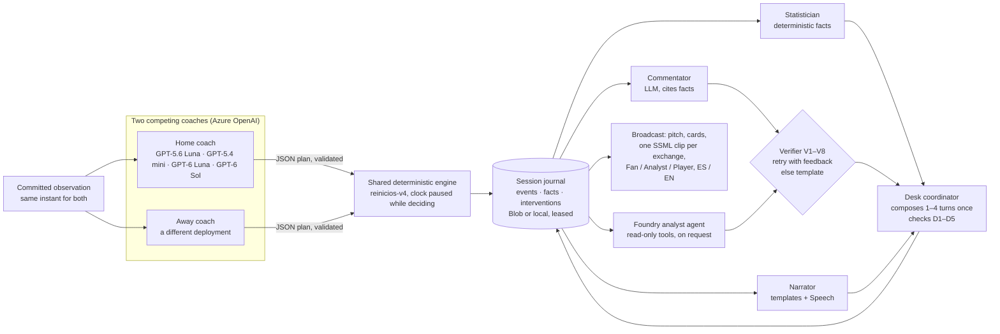

# CRONISTA

**Two AI coaches play a synthetic football match on a shared engine while a three-voice broadcast desk narrates, analyses and quotes the numbers, and every sentence it says can be traced back to the match events that justify it.**

[**Open the live arena**](https://cronista-arena.mangoocean-cf77f6f8.eastus2.azurecontainerapps.io/arena) ·
[Verified match recap demo](https://cronista.mangoocean-cf77f6f8.eastus2.azurecontainerapps.io) ·
[Demo video](VIDEO_URL) ·
[Try it in two minutes (judges' guide)](docs/entrega/judges-guide.md) ·
[Elevator pitch](docs/entrega/pitch.md)



Built for the **Inside the Game** hackathon (Microsoft × Premier League). Target category: **Best Multi-Agent System**; it also fits **Best Azure Cloud Native Integration** because every agent runs on Azure Container Apps with Blob journals, Key Vault, Application Insights, Azure OpenAI, Azure Speech and a Microsoft Foundry agent. Everything is synthetic: fictional countries, clubs, players, coaches and broadcasters. Nothing is real footage or real data.

## What you can see today

| Piece | What happens | Evidence |
|---|---|---|
| **Live arena** (`/arena`) | Two LLM team controllers drawn from four Azure OpenAI deployments (GPT-5.6 Luna, GPT-5.4 mini, GPT-6 Luna, GPT-6 Sol) receive the same committed observation, return a JSON plan per player, and a deterministic 2D engine resolves movement, passes, crosses, keeper behaviour, fouls, cards and substitutions. The simulation clock pauses while both coaches decide. | [Public smoke, 21 Oct](docs/evidencia/publicacion-048/smoke-publico.json): 4/4 valid decisions, 3 goals, zero programmed fallbacks |
| **Broadcast desk** | A narrator (templates), a commentator (LLM, verified by rules V1–V8, template fallback) and a statistician (deterministic) hand the floor to each other in 1–4 turn exchanges, in Spanish or English, with one Azure Speech voice per role. | Same smoke: 7 of 7 exchanges composed, 0 structural failures; [real MP3s](docs/evidencia/publicacion-048/) |
| **Inspect facts and checks** | Every desk card and every narrator comment opens its cited facts, event IDs, verifier verdicts and rejected attempts. | [Commentator rejected once, accepted on retry](docs/evidencia/tres-voces/comentarista-azure-real.json) |
| **Ask the match analyst** | A versioned Microsoft Foundry agent with two read-only tools answers "What just happened?", "What has the selected player done?" or "What chances were there?" over the confirmed prefix only. | [Agent `cronista-analista:1`](docs/evidencia/azure-agente.json), [public answer with tool call](docs/evidencia/azure-arena-publica-smoke.json) |
| **Verified match recap** (original app) | Simulator → deterministic Analyst → LLM Writer (GPT-6.1 Sol) → deterministic Verifier. Click any sentence to see its events; open the Glass Box to read the drafts that were rejected and why. | [20-match evaluation](docs/evidencia/eval-gpt-6.1-sol/informe.txt), [public browser check](docs/evidencia/smoke-browser-public.json) |

## How it meets the challenge (§4.1)

| Stage / feature | Where CRONISTA does it | Links |
|---|---|---|
| **Ingest** events as they happen | The arena engine emits passes, carries, shots, saves, crosses, keeper throw-outs, fouls, cards, substitutions and restarts at a fixed 0.1 s step; sessions stream them over SSE with a 20-second buffer. The recap app ingests ~2,100 seeded micro-events per match. | [`src/arena/motor.ts`](src/arena/motor.ts), [buffered broadcast](docs/disenos/038-emision-con-buffer.md) |
| **Interpret** into stats and patterns | Deterministic statistician (score, shots on target, saves, fouls, substitutions, share of actions, pass distance) with event evidence per datum; deterministic Analyst with 13 fact types in the recap app. | [`src/arena/estadista.ts`](src/arena/estadista.ts), [`src/analista/`](src/analista/) |
| **Explain** why a moment matters | Commentator sentences must cite a fact and pass V1–V8; Foundry analyst answers on request; recap sentences show their evidence and rejected drafts. | [Brief 045](docs/disenos/045-tres-voces.md), [`src/arena/agente.ts`](src/arena/agente.ts), [`src/cadena/verificador.ts`](src/cadena/verificador.ts) |
| **Render** beside the match | Scoreboard, pitch with shirt numbers, referee, broadcast desk cards, live text and audio; machine-readable overlay JSON per match in the recap app. | [`src/ui/ArenaMesa.tsx`](src/ui/ArenaMesa.tsx), [`src/app/api/overlay/[seed]/route.ts`](src/app/api/overlay/[seed]/route.ts) |
| **Personalize** | Fan / Analyst / follow-a-player views computed from the visible prefix; ES/EN for text and voices; recap app adds team perspective and fan/analyst prose. | [`src/arena/inteligencia.ts`](src/arena/inteligencia.ts), [`src/cadena/personalizacion.ts`](src/cadena/personalizacion.ts) |
| Narrative generation | Three-voice desk with handovers, questions and closings; bilingual verified recaps; full-match possession commentary. | [Brief 048](docs/disenos/048-dialogo-entre-voces.md), [Brief 003](docs/disenos/003-cronista-verificador.md) |
| Explainability | "Inspect facts and checks" on every card; Glass Box with every draft and verdict; a maintained battery of adversarial lies the Verifier must reject. | [How verification works](#how-verification-works) |
| Data innovation | Seeded, byte-reproducible simulator (~2.9 goals per match, 79.6 % pass completion, conditions proven by A/B over 500 matches) with a downloadable dataset and datasheet; a separate 2D spatial engine with 12 formations, coaches, traits, weather and a referee. | [Datasheet](docs/dataset/DATASHEET.md), [`src/sim/limites.ts`](src/sim/limites.ts), [Arena guide](docs/arena.md) |
| Multi-language | Every template, prompt, verifier rule and voice exists in ES and EN; the verifier checks that both languages agree on every number (V6). | [`src/sim/limites.ts`](src/sim/limites.ts) (`MESA_ARENA`), [`src/arena/voz.ts`](src/arena/voz.ts) |

## The multi-agent system

Orchestration is custom TypeScript hosted on Azure, which the category text admits as "another supported orchestration approach". Microsoft Agent Framework, MCP and A2A are **not** implemented. Every model call goes through one seam, [`src/lib/llm.ts`](src/lib/llm.ts), which also enforces per-session call budgets.



### Agent roster

| Agent | Implementation | Inputs → outputs |
|---|---|---|
| Home / Away coach | LLM, one deployment each from a server-side catalogue (the public app draws from `cronista-equilibrado` = GPT-5.6 Luna, `cronista-rapido` = GPT-5.4 mini and `cronista-sol6` = GPT-6 Sol, `cronista-luna6` = GPT-6 Luna; a Foundry Models adapter, [`src/lib/llm-foundry-modelos.ts`](src/lib/llm-foundry-modelos.ts), can serve other families, but Grok 4.7 and gpt-oss-120b did not pass the admission smoke: [evidence](docs/evidencia/modelos-052/README.md)), strict JSON schema, 60 s deadline, one correction with feedback | Positions, ball, score, time left, traits, energy, bench, conditions, crowd, public opponent actions, own last valid plan → per-player orders (`pasar`, `conducir`, `centrar`, `presionar`, …), mentality, width, block, substitution requests. [`src/arena/controladores.ts`](src/arena/controladores.ts), [`src/arena/competencia.ts`](src/arena/competencia.ts) |
| Engine + local player control | Deterministic, versioned rules (`reinicios-v4`) | Plans → movement, contacts, trajectories, keeper decisions, fouls, cards, restarts; events with IDs. [`src/arena/motor.ts`](src/arena/motor.ts), [`src/arena/portero.ts`](src/arena/portero.ts), [`src/arena/ataque.ts`](src/arena/ataque.ts) |
| Narrator | Deterministic templates; Azure Speech voice per language; optional LLM comments verified by V1–V8 | Confirmed events → play-by-play text and SSML; handovers, questions and closings for the desk. [`src/arena/relato.ts`](src/arena/relato.ts), [`src/arena/narrador.ts`](src/arena/narrador.ts) |
| Commentator | LLM through `src/lib/llm.ts`, ≤ 2 sentences, each citing a fact; V1–V8 with one retry, template fallback | Last 8 allowed facts + the "desk datum" → verified analysis. [`src/arena/mesa.ts`](src/arena/mesa.ts) |
| Statistician | Deterministic | Confirmed prefix → score, shots, saves, fouls, substitutions, share of actions, pass distance, each with event evidence. [`src/arena/estadista.ts`](src/arena/estadista.ts) |
| Desk coordinator | Deterministic, pure functions | Verified sentences + datum → one exchange of 1–4 turns in two variants (full and short), checked by rules D1–D5, published once. Client side picks the variant that fits the calm window and never interrupts narrator news. [`src/arena/dialogo.ts`](src/arena/dialogo.ts), [`src/arena/turnos.ts`](src/arena/turnos.ts) |
| Match analyst | Microsoft Foundry Agent Service, versioned agent `cronista-analista:1`, tools `consultar_eventos` and `consultar_jugador` (read-only, reject future ticks and foreign IDs) | Viewer question + tick → ≤ 3 agent requests, tool calls logged, sentences verified by V1–V8 or labelled template fallback. [`src/arena/agente.ts`](src/arena/agente.ts) |
| Verifier | Deterministic rules V1–V8, shared by recap Writer, narrator comments, commentator and analyst | Sentence + cited facts → verdict with rule-specific feedback. [`src/cadena/verificador.ts`](src/cadena/verificador.ts) |

**Shared state.** The session journal (`PublicacionSesion` entries: states, events, decisions, comments, interventions) lives in Azure Blob Storage with a renewable lease, or in a local directory in development; the event log (`RegistroArena`) and the fact list (`hechosArena`, IDs like `arena:a13`) are what every agent reads and cites. Reconnecting, replaying or sharing a match re-reads the journal and never triggers new inference. [Blob restart, exclusion and cache checks](docs/evidencia/azure-servicios-smoke.json).

**Handoffs.** Both coaches receive the observation committed at the same instant; a late answer cannot change the past. Desk candidacies are generated **once** on the server with a stable ID (`role:topic:tick`) and published to the journal; the narrator's handover and the guest's reply are synthesised as **one SSML document with two or more `<voice>` elements**, so a hand-over is a single clip with one priority and one memory entry. [Brief 045](docs/disenos/045-tres-voces.md), [a 4-voice round in Spanish, 177 characters in about 16.7 s](docs/evidencia/publicacion-048/publico-ronda-457-es.mp3).

**Failure recovery.** Invalid or late coach plans get one correction with feedback, then a recorded programmed fallback (`respaldo`), never a stalled match. Commentator and narrator comments that fail V1–V8 are retried once with the failing rule, then fall back to a verified template, visibly labelled. Narrator and commentator share a budget of 12 model calls per session; Speech has per-session and per-day request and character budgets, and a separate pool for the guest voices so a guest can never cause a narrator 429. Bundled backup clips cover Speech delays after two seconds of silence. Blob reservations survive restarts, so an interrupted request is never silently paid twice. [Limits and recovery](docs/azure-integraciones.md#límites-y-recuperación), [`MESA_ARENA`](src/sim/limites.ts).

**Why not one agent.** The two coaches must not see each other's private plan, so they need separate contexts and a neutral engine that commits both plans at once. The statistician and the verifier are deterministic because a model cannot certify its own numbers; the commentator is the only desk voice allowed to interpret, and only with a cited fact. The analyst is a separate Foundry agent because it answers on demand with tools, under its own quota, without touching the live budget. Honest counterpoint: the two paired Foundry evaluations of the recap pipeline did **not** show an improvement over a first draft ([first run](docs/evidencia/arena-eval-foundry/README.md), [second judge](docs/evidencia/arena-eval-revision-alcance/README.md)); the value we can show is traceability and recovery, not better prose.

## Microsoft and Azure technologies

| Technology | Used for | Where |
|---|---|---|
| Azure OpenAI (GPT-6.1 Sol for recaps; GPT-5.6 Luna, GPT-5.4 mini, GPT-6 Luna and GPT-6 Sol as coaches; GPT-5.4 mini for narrator comments and commentator) | All published LLM inference, strict JSON schema, reasoning effort `low` | [`src/lib/llm-azure-openai.ts`](src/lib/llm-azure-openai.ts), [`infra/modelos-arena.json`](infra/modelos-arena.json), [`infra/modelos-arena.bicep`](infra/modelos-arena.bicep) |
| Foundry Models (Model Inference API) | Adapter for coaches from other model families behind the same seam; admission only after a real smoke (22/22 valid decisions, none over 30 s). Tried: Grok 4.7 (too slow) and gpt-oss-120b (truncated at 2,048 tokens), not admitted; DeepSeek and Llama had no quota or Marketplace offer | [`src/lib/llm-foundry-modelos.ts`](src/lib/llm-foundry-modelos.ts), [evidence](docs/evidencia/modelos-052/README.md) |
| Microsoft Foundry Agent Service (`@azure/ai-projects`) | Versioned analyst agent with function tools; identity-based access (Foundry User role) | [`src/arena/agente.ts`](src/arena/agente.ts), [`src/arena/agente-cli.ts`](src/arena/agente-cli.ts), [identity fix](docs/evidencia/azure-foundry-identidad-publica.json) |
| Microsoft Foundry Evaluation | Paired groundedness evaluation of draft vs pipeline | [`src/arena/foundry-eval.ts`](src/arena/foundry-eval.ts) |
| Microsoft Foundry (Claude adapter, `@anthropic-ai/foundry-sdk`) | Implemented adapter; deployment blocked by Marketplace eligibility, so not used in the public apps | [`src/lib/llm-foundry.ts`](src/lib/llm-foundry.ts), [status](docs/evidencia/smoke-foundry-pendiente.json) |
| Azure AI Speech | One neural voice per role and language, SSML with styles and prosody, voice catalogue checked at runtime | [`src/arena/voz.ts`](src/arena/voz.ts), [`src/arena/expresion.ts`](src/arena/expresion.ts) |
| Azure Blob Storage (`@azure/storage-blob`) | Journals, replay files, cached answers/audio, leases and durable request reservations | [`src/arena/almacen.ts`](src/arena/almacen.ts), [`infra/servicios-arena.bicep`](infra/servicios-arena.bicep) |
| Azure Key Vault + managed identity (`@azure/identity`) | Secret reference for the model/Speech key; no keys in the image | [`infra/arena-preview.bicep`](infra/arena-preview.bicep), [`src/lib/azure.ts`](src/lib/azure.ts) |
| Azure Monitor / Application Insights / Log Analytics (`@microsoft/opentelemetry`) | Explicit spans per session, decision, narration, verification, tool, voice; connected to the Foundry project | [`src/lib/telemetria.ts`](src/lib/telemetria.ts), [public traces](docs/evidencia/azure-trazas-publicas.json), [`infra/conectar-trazas-foundry.bicep`](infra/conectar-trazas-foundry.bicep) |
| Azure Container Apps (two apps, one warm replica each during judging) | Public hosting of the arena and the recap demo | [`infra/arena-preview.bicep`](infra/arena-preview.bicep), [`infra/app.bicep`](infra/app.bicep), [`scripts/deploy-azure-arena.mjs`](scripts/deploy-azure-arena.mjs) |
| Azure Container Apps Job | Manual batch worker for offline evaluation corpora (completed with zero model calls) | [`infra/evaluaciones-job.bicep`](infra/evaluaciones-job.bicep), [run](docs/evidencia/azure-lotes.json) |
| Azure Container Registry | Remote image builds (`az acr build`) from an allow-listed source context, pulled with managed identity | [`infra/registry.bicep`](infra/registry.bicep), [`scripts/deploy-azure.mjs`](scripts/deploy-azure.mjs) |
| Bicep + Azure CLI | All infrastructure as code; templates compiled in CI | [`infra/`](infra/), [`.github/workflows/ci.yml`](.github/workflows/ci.yml) |
| GitHub Actions, GitHub CLI | CI with three jobs (tests, Playwright, container + Bicep); repo and run management | [CI runs](https://github.com/calusaca/cronista/actions) |

Not used: Microsoft Agent Framework, MCP, A2A, Fabric, AKS.

## Quality

Validated on 21 October 2026 and recorded in [BITACORA.md](BITACORA.md):

- `npm run typecheck`; **1,788 unit, invariant, oracle and lie-battery tests in 80 files** (`npm test`); **58 statistical checks** over N = 1,000 matches plus A/B condition proofs (`npm run test:stats`); **129 Playwright journeys in 29 files** (`npm run e2e`), all in [CI run 39683620221](https://github.com/calusaca/cronista/actions/runs/39683620221) on the published commit.
- Hand-run mutation testing on the engine rules of brief 046: [57 of 57 mutants killed](docs/evidencia/motor-046/mutaciones-046.json); the dialogue and voice briefs record their own red mutations.
- Briefs 045, 046 and 048 went through an independent code review (GPT-6.1 Sol via Codex) and an adversarial audit agent before release; findings and fixes are archived under [`docs/evidencia/tres-voces/`](docs/evidencia/tres-voces/README.md), [`motor-046/`](docs/evidencia/motor-046/README.md) and [`dialogo-048/`](docs/evidencia/dialogo-048/README.md).
- Engine rules v4 measured on 100 seeds versus v3: keeper steals after a save 18 → 0, keeper advance in one-on-ones median 0 → 1.34 m, wide passes into the box 12.6 % → 49 %, goals after a lost throw-out 0.08 → 0 per match ([batches](docs/evidencia/motor-046/)). The redesign passed every measured contrast pair in light and dark mode ([table](docs/evidencia/rediseno-047/contraste-despues.txt)).
- Deployment checks: Bicep compilation, Docker image, HTTP smoke, non-root user and writable cache in CI; public smoke and Chromium walkthroughs at desktop and 360 px after each release ([latest](docs/evidencia/publicacion-048/)).

## How verification works

One sentence narrates exactly **one fact**. The Verifier checks, per sentence: schema (V1), citations exist (V2), every number appears in the narrated fact (V3), every proper name belongs to it (V4), every required fact is narrated and not just cited (V5), ES and EN agree on every figure (V6), negations are backed by a recorded zero (V7), and strong claims are allowed only when the fact's data pays for them (V8). Red-team lie batteries from five adversarial rounds ship as permanent tests. Narrator questions and closings on the desk are templates that cannot pass V8 by design (it rejects questions), so they pass a separate structural check D1–D5: they may only name people and actions copied from records referenced by ID.

## Responsible AI and known limits

- **100 % synthetic.** Fictional countries, clubs, players, coaches, referees and broadcaster names; no real footage, data or trademarks. Six third-party broadcast transcripts informed the desk's turn-taking design but are [not distributed](docs/referencias-transcripts.md) and never enter templates (a hash test enforces it).
- **V1–V8 verify what they cover.** Citations, numbers, names, structure and listed claim patterns are checked deterministically; they do not prove the relevance of an analysis, and a novel assertion outside the maintained lexicon can pass ([reproduced example](docs/evidencia/verificador-2026-10-10.md)). The commentator is labelled "analysis with cited facts", not opinion.
- **The arena is a short 2D prototype.** Simplified restarts, no aerial play, no penalties, uncalibrated movement; it is not a regulation match, and neither its results nor the recorded duels measure model superiority ([arena guide](docs/arena.md)).
- **No demonstrated prose improvement.** Both recap evaluations found zero verifier flags in baseline and pipeline (0/163 vs 0/167) and the Foundry judge scored draft and pipeline equal; we claim traceability and recovery, not better writing.
- **Budgets, not guarantees.** Daily and per-session caps bound spend; the 20-second buffer is not a latency guarantee; Speech delays are covered by backup clips. Human review of voice naturalness is pending.
- Player ratings in the recap app are arithmetic over events with a clickable breakdown, not model opinion.

## Quick start

```bash
npm ci            # Node 22 or newer (CI uses 22 and 24)
npm run dev       # offline stub mode → http://localhost:3000 (redirects to /arena); 90-minute recaps at /cronicas
npm test && npm run test:stats && npm run e2e
```

Offline, the recap Writer is a visibly labelled deterministic stub and the arena runs programmed coaches, saved matches and replays without any model call. Real inference: copy `.env.example` to `.env`, set `CRONISTA_LLM=azure-openai` and the Azure variables; the arena's model catalogue, Speech, Blob, Key Vault and Foundry settings are described in the [arena guide](docs/arena.md#configuración-del-servidor-y-límites) and [Azure integrations](docs/azure-integraciones.md). Deployment runbook: [docs/entrega/despliegue.md](docs/entrega/despliegue.md).

```bash
npm run arena -- --modo llm --segundos 10 --intervalo 5 --salida .cache/arena-modelos.json   # two LLM coaches from the CLI
npm run arena -- --reproducir .cache/arena-modelos.json                                     # recompute without inference
node --import tsx docs/evidencia/eval-gpt-6.1-sol/reproducir.mjs                            # replay the recorded recap evaluation
```

## Documentation

[Judges' guide](docs/entrega/judges-guide.md) · [Pitch](docs/entrega/pitch.md) · [Video shot list](docs/entrega/guion-video.md) · [Arena guide](docs/arena.md) · [Azure integrations](docs/azure-integraciones.md) · [Design briefs 000–048](docs/disenos/) · [Evidence](docs/evidencia/) · [Work log and known debts](BITACORA.md) · [Hackathon rules summary](docs/hackathon.md) · [Official rules](https://github.com/microsoft/insidethegamehackathon/blob/main/OFFICIAL%20RULES.md) · [License](LICENSE)
