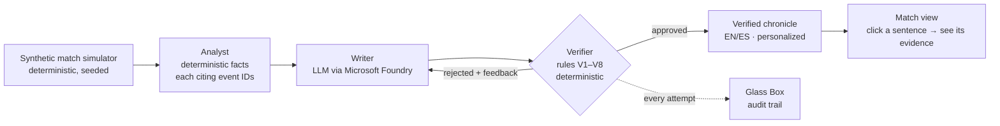

# CRONISTA

**AI match chronicles where every sentence can be proven with a click.**

<!-- PLACEHOLDER: GIF of the rejection moment (Glass Box catching a lie) -->
<!-- PLACEHOLDER: ▶ Try it live: [demo URL] · 🎬 2-minute video: [video URL] -->

Most AI-generated sports recaps have a problem nobody can see: they invent
details — a wrong minute, a goal that never happened, a penalty that never was.
CRONISTA generates bilingual (EN/ES) football match chronicles from synthetic
match events, and **no unverified sentence ever reaches the reader**: a
deterministic Verifier checks every sentence against the match events before
publication, and the Glass Box lets you watch it work — including the drafts it
rejected and why.

Built for the **Inside the Game** hackathon (Microsoft × Premier League):
explainable match intelligence, real-time narratives, and automated match recaps,
flexible enough for fans in any market.

## Architecture



## The multi-agent system (Best Multi-Agent System category)

| Category requirement | How CRONISTA meets it |
|---|---|
| Distinct roles | Simulator (data), Analyst (deterministic facts), Writer (LLM prose), Verifier (deterministic judge) — no role overlaps |
| Shared state | The event log and the fact list are the single source of truth every agent reads and cites |
| Effective handoffs | Facts carry event citations; sentences carry fact citations; the audit trail records every handoff |
| Recover from failures | Rejected sentences trigger retries with rule-specific feedback (max 2); unrecoverable output falls back to a 100%-faithful template chronicle — never a lie |
| Outcome a single agent could not achieve | A lone LLM publishes unsupported claims; our pipeline publishes zero. Reproducible comparison: `npm run eval` <!-- PLACEHOLDER: eval headline number --> |

## How verification works

One sentence narrates exactly **one fact**. The Verifier checks, per sentence:
schema (V1), citations exist (V2), every number — digits or words — appears in
the narrated fact (V3), every proper name belongs to it (V4), every required
fact is narrated, not just cited (V5), negations must be backed by a recorded
zero (V7), and strong claims are allowed only when the fact's data pays for
them (V8) — "dominated" needs the possession, "match-winner" needs the score
sequence, "wilted in the heat" needs the measured second-half drop in **that**
match, "bicycle kick" needs the recorded shot type, and an own goal forbids
crediting "scored" to the rival. ES and EN must agree on every figure (V6).
Red-team lie batteries crafted across five adversarial audit rounds ship as
permanent tests; all are rejected.

## A living fictional world

Everything runs on a fully synthetic world — 8 fictional countries with
climates, one league each (10 teams, double round-robin), all navigable:

- **League mode**: standings, matchdays, top scorers; every result opens the
  full report.
- **Conditions that really bite**: heat slows the second half, rain degrades
  passing, synthetic turf speeds up shots, tall grass bogs down the visitors —
  each effect statistically proven (A/B over 500 matches), and the chronicle
  may only mention an effect **measured in that match**.
- **Consequences across matchdays**: red cards suspend, injuries sideline for
  1–4 matchdays, lineups adjust — and every player accrues a season rating
  that unfolds, click by click, into the per-match ratings that produced it.
- **Goals with soul**: headers, one-on-ones, chips, bicycle kicks (0.25% of
  goals), halfway-line screamers (0.14%), own goals under the FIFA rule — each
  with hard coherence constraints on distance, speed, and origin.
- **Live replays** of any match, minute by minute, with a no-clairvoyance
  guarantee: the ticker at minute M cites nothing from the future.
- **The goal as a diorama**: every goal card offers a 2D tactics board and a
  3D scene — procedural, lazy-loaded (133 KB), where **only the ball moves**,
  because only the ball's trajectory is recorded data. Player pieces stay
  still in their recorded zones. The label says so, always.

## Microsoft technologies

<!-- Map each to its file; list ONLY what is actually used. -->
| Technology | Where |
|---|---|
| Microsoft Foundry (Claude / Azure OpenAI deployment) | `src/lib/llm-foundry.ts` |
| Azure Container Apps (demo hosting) | <!-- PLACEHOLDER: deploy notes --> |
| GitHub Actions (CI: 1,100+ tests + Playwright e2e) | `.github/workflows/ci.yml` |
| GitHub CLI | repo management |

## Quick start (no API key needed)

```bash
npm ci
npm run dev        # offline stub mode → http://localhost:3000
```

The stub writer is deterministic, so the full pipeline — simulator, analyst,
verifier, Glass Box, league mode, live replay, 3D board — runs offline. Real
prose: set `CRONISTA_LLM=foundry` and the variables in `.env.example`.

```bash
npm test           # 1,137 unit/invariant/oracle/lie-battery tests
npm run test:stats # statistical realism: N=1000 matches + A/B condition proofs
npm run e2e        # 41 journeys driven with a real mouse (Playwright)
```

## Synthetic data

No real match footage or data is used anywhere. The simulator generates
football-realistic matches (seeded, byte-for-byte reproducible): ~2.9 goals
per match, the stronger team wins 63%, red cards in 12.5%, ~25% draws (Premier
League: ~24%), three distinguishable play styles, and **~2,100 micro-events
per match** (passes with 79.6% completion, dribbles, duels) with causal
continuity — the receiver of a pass is the next actor. Realism is enforced by
a statistical test suite over 1,000 matches plus per-condition A/B proofs.
All countries, leagues, teams and players are fictional.

## Responsible AI & known limitations

- **100% synthetic data; no real people, clubs, or trademarks.**
- **No unverified sentence reaches the reader.** When the Verifier cannot back a
  sentence after retries, it is omitted or the chronicle falls back to a
  template-based report — visibly labeled, never disguised.
- **Causal honesty, not just factual honesty.** "They never settled on the tall
  grass" is blocked when it also rained — the rain, not the grass, could
  explain the drop. The same losses are never narrated twice under two names.
- **Honest limits:** verification of numbers, names, structure and listed strong
  claims is deterministic and tested; a novel rhetorical figure outside the
  maintained lexicon could pass. The Glass Box makes every published sentence
  inspectable, and the lie battery grows with every red-team round.
- Player ratings are computed from events with a clickable breakdown — auditable
  arithmetic, not AI opinion. Season ratings are the audited per-match ratings,
  averaged, with the full list one click away.

<!-- PLACEHOLDER: GitHub tooling section (Copilot review if enabled) -->
<!-- PLACEHOLDER: screenshots / live replay GIF -->
<!-- Nota al congelar: reconciliar TODAS las cifras contra la suite real del
     momento (hoy: 1137 unit, 36 stats, 41 e2e; conteo de mentiras pendiente
     de recuento exacto) y llenar los placeholders de URLs, eval y GIF. -->
