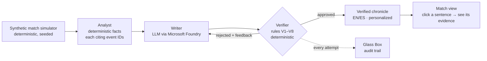

# CRONISTA

**AI match chronicles where every sentence can be proven with a click.**

<!-- PLACEHOLDER: GIF of the rejection moment (Glass Box catching a lie) -->
<!-- PLACEHOLDER: ▶ Try it live: [demo URL] · 🎬 2-minute video: [video URL] -->

Most AI-generated sports recaps have a problem nobody can see: they invent
details — a wrong minute, a goal that never happened, a penalty that never was.
CRONISTA generates bilingual (EN/ES) football match chronicles from synthetic
match events, and **no unverified sentence ever reaches the reader**: a
deterministic Verifier checks every sentence against the match events before
publication, and the Glass Box lets you watch it work — including the drafts it
rejected and why.

Built for the **Inside the Game** hackathon (Microsoft × Premier League):
explainable match intelligence, real-time narratives, and automated match recaps,
flexible enough for fans in any market.

## Architecture



## The multi-agent system (Best Multi-Agent System category)

| Category requirement | How CRONISTA meets it |
|---|---|
| Distinct roles | Simulator (data), Analyst (deterministic facts), Writer (LLM prose), Verifier (deterministic judge) — no role overlaps |
| Shared state | The event log and the fact list are the single source of truth every agent reads and cites |
| Effective handoffs | Facts carry event citations; sentences carry fact citations; the audit trail records every handoff |
| Recover from failures | Rejected sentences trigger retries with rule-specific feedback (max 2); unrecoverable output falls back to a 100%-faithful template chronicle — never a lie |
| Outcome a single agent could not achieve | A lone LLM publishes unsupported claims; our pipeline publishes zero. Reproducible comparison: `npm run eval` <!-- PLACEHOLDER: eval headline number --> |

## How verification works

One sentence narrates exactly **one fact**. The Verifier checks, per sentence:
schema (V1), citations exist (V2), every number — digits or words — appears in
the narrated fact (V3), every proper name belongs to it (V4), every required
fact is narrated, not just cited (V5), negations must be backed by a recorded
zero (V7), and strong claims ("dominated", "match-winner", "clean sheet") are
allowed only when the fact's data pays for them (V8). ES and EN must agree on
every figure (V6). 141 red-team-crafted lies live in the permanent test battery;
all are rejected.

## Microsoft technologies

<!-- Map each to its file; list ONLY what is actually used. -->
| Technology | Where |
|---|---|
| Microsoft Foundry (Claude / Azure OpenAI deployment) | `src/lib/llm-foundry.ts` |
| Azure Container Apps (demo hosting) | <!-- PLACEHOLDER: deploy notes --> |
| GitHub Actions (CI: 500+ tests + Playwright e2e) | `.github/workflows/ci.yml` |
| GitHub CLI | repo management |

## Quick start (no API key needed)

```bash
npm ci
npm run dev        # offline stub mode → http://localhost:3000
```

The stub writer is deterministic, so the full pipeline — simulator, analyst,
verifier, Glass Box, live replay — runs offline. Real prose: set
`CRONISTA_LLM=foundry` and the variables in `.env.example`.

```bash
npm test           # 500+ unit/invariant/oracle/lie-battery tests
npm run test:stats # statistical realism of the simulator, N=1000 matches
npm run e2e        # the judge's path, driven with a real mouse (Playwright)
```

## Live replay & broadcast overlay

**Watch live** on any match view replays the simulated match minute by minute
(labeled **Replay** — it is a deterministic match played back, not a live
broadcast). At each key moment (goal, red card, half-time, full time) the Writer
produces a short update from the facts known *up to that minute* — the Analyst
runs on the event prefix — and the update passes the same Verifier (V1–V8)
before it reaches the ticker. No clairvoyance: an update at minute M cites only
events with minute ≤ M and no figure from the future (tested over seeds 1–100).
If the Writer's drafts are rejected after retries, the ticker shows the fact's
template instead. Speed ×1 / ×5 / pause, and **Skip to full-time** opens the full
chronicle.

**Integration point for studios / streaming overlays:** the same verified updates
are served as timed, machine-readable JSON (the ticker consumes this endpoint, so
what the viewer sees and what an overlay receives are the same data):

```
GET /api/overlay/{seed}[?perspectiva=local|visita]
```

```json
{
  "seed": 246, "replay": true, "llm": "stub", "modo": "neutral",
  "local": "…", "visita": "…",
  "actualizaciones": [
    { "minuto": 3, "texto_es": "…", "texto_en": "…", "hecho": "h02",
      "eventos": ["e004", "e005"], "momento": "gol-e005", "tipo": "gol",
      "verificacion": "llm", "intentos": 1 }
  ]
}
```

`actualizaciones` is ordered by `minuto`; each entry is one verified sentence
(`hecho` is the fact it narrates — facts are computed on the event prefix, so
fact IDs are local to their `momento`; `eventos` are global match event IDs that
back the sentence, all at minute ≤ `minuto`). `verificacion` is `llm` (written by the Writer, approved) or
`plantilla` (the fact's template after rejected drafts). The schema is
`esquemaOverlay` in `src/vivo/overlay.ts` (zod). Updates are cached per
(seed, moment, deployment, perspective): with a real model, ~5–8 calls per match,
once.

## Synthetic data

No real match footage or data is used anywhere. The simulator generates
football-realistic matches (seeded, byte-for-byte reproducible) whose realism is
enforced by a statistical test suite over 1,000 matches: ~2.9 goals per match,
the stronger team wins 63%, red cards in 12.5%, three distinguishable play
styles. All teams and players are fictional.

## Responsible AI & known limitations

- **100% synthetic data; no real people, clubs, or trademarks.**
- **No unverified sentence reaches the reader.** When the Verifier cannot back a
  sentence after retries, it is omitted or the chronicle falls back to a
  template-based report — visibly labeled, never disguised.
- **Honest limits:** verification of numbers, names, structure and listed strong
  claims is deterministic and tested; a novel rhetorical figure outside the
  maintained lexicon could pass. The Glass Box makes every published sentence
  inspectable, and the lie battery grows with every red-team round.
- Player ratings are computed from events with a clickable breakdown — auditable
  arithmetic, not AI opinion.

<!-- PLACEHOLDER: GitHub tooling section (Copilot review if enabled) -->
<!-- PLACEHOLDER: screenshots / live replay GIF -->
