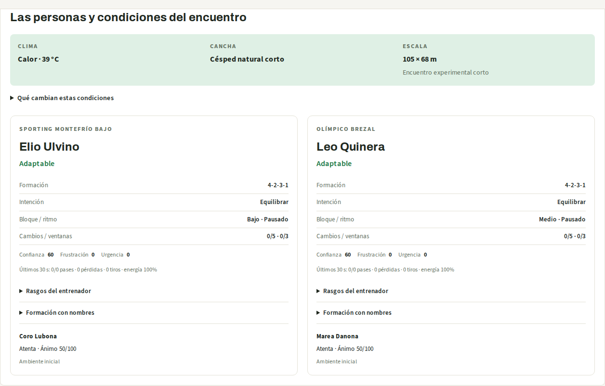

# Laboratorio experimental de equipos

El [brief 034](disenos/034-arena-dos-controladores.md) implementa dos controladores
independientes sobre un motor espacial compartido. El simulador de las crónicas y
su dataset histórico conservan su comportamiento. La página `/arena` permite
inspeccionar el experimento en inglés o español.

[Abrir la nueva arena pública](https://cronista-arena.mangoocean-cf77f6f8.eastus2.azurecontainerapps.io/arena).
La aplicación anterior conserva su dirección y versión.

## Qué se puede probar

- En la nueva arena pública, las ejecuciones usan `arena-v3`: entrenadores,
  adaptación táctica, banco, sustituciones, condiciones activas y arbitraje
  simplificado, además de personalidades, capitanes y árbitro visible.
- 22 titulares iniciales y diez suplentes con identidad persistente; doce formaciones y cambios de
  estructura con/sin balón, apoyos, presión cercana y cobertura.
- Paso fijo de 0,1 s con velocidad y aceleración acotadas. Fotogramas cada 0,5 s;
  reproducción interpolada o estados discretos con movimiento reducido.
- Trayectorias de pases, recepciones, interceptaciones, recuperación, tiros,
  atajadas, goles y fuera de juego puntual al intervenir un receptor.
- Observación compartida, órdenes simultáneas, plazos, cancelación y respaldo.
- Registro descargable y reproducción recalculada sin inferencia. Comprobar la
  consistencia del archivo no autentica la identidad del modelo que lo produjo.

Los planes contienen un objetivo por jugador activo: once inicialmente y menos
tras una expulsión. El control local reacciona ante
cambios de posesión, recepción y balón cercano durante el intervalo. Un pase que
se detiene conserva su referencia de fuera de juego hasta el siguiente contacto.
Los golpes se fechan en el paso que avanza, sin añadir eventos al prefijo anterior.

## Prueba en el navegador

La entrada predeterminada es **En vivo**. Configura antes de iniciar las formaciones
iniciales, la duración y, si quieres, clima, cancha y público. «Decide el entrenador»
permite que cada técnico elija su formación. La semilla queda en **Repetir un partido
específico (avanzado)**: es un número que determina equipos y condiciones iniciales.
Vacía sortea una configuración nueva; repetirla no obliga al modelo a decidir igual.

La emisión usa la reserva de 20 segundos del [brief 038](disenos/038-emision-con-buffer.md)
mientras el partido sigue generándose. La cancha mantiene su propio reloj; la voz
consume ese cursor de forma independiente y nunca limita su avance. Solo una falta
de datos del partido puede requerir recuperar reserva. La interfaz la llama **En vivo**.
El tamaño del búfer no garantiza una espera inicial ni un retraso máximo.
**Compartir esta emisión** incorpora a otro espectador sin generar otro encuentro.

La [narración selectiva](disenos/040-consumidores-y-narracion.md) combina momentos
importantes con contexto de las secuencias observadas. Admite pasajes más largos,
a velocidad natural, descarta los atrasados y da prioridad a goles y otras noticias.
La [sincronía de voz](disenos/042-sincronia-y-saque-inicial.md) limita a tres segundos
el atraso para iniciar una intervención. Cada activación pide una entrada desde
el instante visible; silenciar conserva preparación futura y reactivar descarta
jugadas anteriores. La voz de jugadas es breve y los comentarios ceden ante
remates y saques relevantes.
La [continuidad de voz](disenos/041-reinicios-y-continuidad-de-voz.md) añade una
intervención sobre el estado observado cuando no hay noticia y audios de respaldo
incluidos en la aplicación: tras dos segundos sin voz cubren demoras de Speech.
El objetivo es no superar cinco segundos de silencio con audio habilitado, pestaña
visible y reproducción autorizada; una pausa manual también pausa la voz.
Un comentario de cierre puede continuar después del final del juego. El panel ofrece
una descripción completa, paginada y sincronizada, de todas las acciones registradas
hasta el instante visible, además de la vista de últimas acciones.

La [variedad del relato](disenos/043-variedad-de-la-narracion.md) usa memoria de las
intervenciones que llegaron a reproducirse, conservada al silenciar. Alterna
secuencias de recepciones confirmadas, recuperaciones, ubicación, balance reciente
y marcador. Comprueba otra vez las repeticiones al iniciar el audio, porque las
ventanas se preparan por adelantado. El respaldo tiene doce comentarios por idioma
y un cierre separado; elige primero los que llevan más tiempo sin oírse. Los
transcripts aportan patrones de estilo; no se entrenó un modelo nuevo.

**Partidos guardados** reúne ejemplos archivados, importación y creación de grabaciones.
Puedes generar una grabación completa o crearla sin IA. Los ejemplos no hacen nuevas
inferencias. El [brief 037](disenos/037-partido-preparado.md) documenta su reproducción.

Junto a la cancha están el audio, el minuto a minuto, el comentario con evidencia y
las vistas de aficionado, analista o jugador. En móvil siguen inmediatamente a la cancha.
La narración de texto funciona con audio apagado y respeta el cursor visible, sin
adelantar resultados que el productor ya generó. Las órdenes individuales quedan en
un desplegable. La [auditoría de reglas, tiros y formaciones](disenos/039-auditoria-futbol-e-interfaz.md)
detalla lo implementado y lo pendiente.

**Escuchar desde el inicio** prepara y decodifica todos los audios antes de
sonar, con progreso por tramos. Después reproduce una pista WAV continua en el
navegador. La cancha sigue el reloj del audio interpolando dentro de cada tramo;
no implica sincronización palabra por palabra. Pausar o buscar en el audio
actualiza la cancha. La reproducción visual sin audio sigue teniendo sus propios
controles. Cambiar de idioma o partido, o detener la preparación, descarta las
respuestas anteriores; los tramos ya reservados pueden terminar y quedar en caché.

El enlace **Abrir o compartir este partido guardado** abre `/arena?partido=ID`.
Los espectadores recuperan el mismo registro mediante
`GET /api/arena/sesiones/ID/reproduccion`, sin nuevas decisiones de equipos.
La caché local/Blob existente sirve también los MP3; solicitudes simultáneas del
mismo audio comparten una síntesis. Retención máxima de 24 horas y límites de
consumo existentes. Un nuevo clic en generar crea otro partido; no se sustituye
silenciosamente por otro que use la misma semilla. Si falla la descarga, se puede
reconectar a la misma sesión sin volver a generarla.

Abre **Team agents lab** desde la barra superior. El escenario inicial y
**Run programmed teams** usan políticas programadas, sin llamadas a IA. Puedes
cambiar semilla, formación y duración; reproducir/pausar, saltar en el tiempo,
abrir las 11 órdenes, cambiar idioma y descargar el registro completo.

**Load recorded AI run** carga el [ejemplo real archivado](../public/experimentos/arena-llm-v1.json):
10 segundos simulados, dos rondas, cuatro decisiones válidas, siete eventos y cero
respaldos. Se generó con dos controladores independientes del **mismo** deployment
Azure OpenAI GPT-6.1 Sol, esfuerzo low. Cargarlo o reproducirlo no llama al modelo.
También puedes abrir un archivo generado por la CLI; el servidor recalcula estados
y eventos y rechaza las inconsistencias.

## Partidos entre modelos y transmisión en vivo

El [plan 035](disenos/035-partidos-en-vivo-y-foundry.md) incorpora un ciclo
competitivo: **observar → decidir simultáneamente → ejecutar → observar el
resultado → adaptar**. El objetivo explícito de ambos modelos es ganar, marcando
y evitando goles. Reciben posiciones, balón, marcador, tiempo restante, habilidad,
energía, personalidades, capitanía, entrenador y su estado, banco, árbitro,
condiciones y afición. Una lectura adicional reúne las acciones públicas del rival,
sus canales de pase recientes y los modificadores ambientales activos. Cada
controlador conserva su propia última propuesta válida. No recibe el próximo plan
privado del contrario ni resultados futuros.

Las decisiones generan objetivos por jugador, amplitud, bloque y gestión del
entrenador. Un motor común resuelve desplazamientos, contactos, trayectorias y
goles. Los modelos dirigen al equipo por intervalos; el control local reacciona a
posesión, recepciones y balón cercano entre consultas. Es competencia entre
entrenadores con ejecución autónoma de jugadores, no una inferencia por toque.
Recibir un parámetro permite considerarlo, pero no demuestra que el modelo lo
aproveche correctamente: esa capacidad necesita evaluación.

El panel **Iniciar un partido en vivo / Start a live match** permite sortear o
elegir los modelos del catálogo. El sorteo es reproducible por semilla y elige
controladores distintos cuando están disponibles. La elección manual admite dos
instancias independientes del mismo modelo y las identifica. La opción programada
ejercita el mismo recorrido sin inferencia. Los ajustes de equipos y entorno del
formulario se aplican a la nueva sesión.

La sesión publica estados, eventos y comentarios durante su ejecución mediante
SSE; recargar reconecta al mismo diario sin repetir llamadas. Cancelar aborta el
trabajo. El reloj simulado **se detiene mientras ambos entrenadores deciden** y
avanza a ritmo real durante cada intervalo. Una respuesta tardía no modifica el
pasado. Al terminar se puede descargar y reproducir el registro completo. La
transmisión continua sin estas esperas requiere planificación asíncrona posterior.

La inteligencia Fan, Analyst o del jugador seleccionado se calcula únicamente
desde el prefijo visible, con enlaces a sus eventos. Los comentarios adicionales
del narrador se generan en paralelo desde hechos confirmados, pasan por V1–V8 y
muestran intentos rechazados o respaldo de plantilla. Las frases simples del
listado de eventos siguen siendo plantillas del motor. El diario conserva los
comentarios y métricas; el JSON de reproducción contiene el encuentro, sin esas
generaciones adicionales del narrador.

### Configuración del servidor y límites

La inferencia web está desactivada por defecto. Configura el servidor con las
credenciales globales habituales y un catálogo de deployments existentes:

```dotenv
ARENA_WEB_LLM=1
ARENA_MODELOS=[{"id":"equilibrado","nombre":"GPT-5.6 Luna","prefijo":"ARENA_EQUILIBRADO_"},{"id":"rapido","nombre":"GPT-5.4 mini","prefijo":"ARENA_RAPIDO_"}]
ARENA_EQUILIBRADO_LLM=azure-openai
ARENA_EQUILIBRADO_AZURE_OPENAI_DEPLOYMENT=cronista-equilibrado
ARENA_EQUILIBRADO_AZURE_OPENAI_REASONING_EFFORT=low
ARENA_RAPIDO_LLM=azure-openai
ARENA_RAPIDO_AZURE_OPENAI_DEPLOYMENT=cronista-rapido
ARENA_RAPIDO_AZURE_OPENAI_REASONING_EFFORT=low
ARENA_NARRADOR_LLM=1
ARENA_NARRADOR_MODELO=rapido
ARENA_SESIONES_DIR=.cache/arena-sesiones
```

`ARENA_NARRADOR_LLM` es opcional e independiente de los entrenadores. El navegador
solo envía IDs; endpoints, claves e instrucciones permanecen en el servidor.
Azure solicita JSON Schema estricto y el validador comprueba también IDs, tiempos,
citas y reglas. Se permite una corrección de formato o semántica, con feedback,
dentro del mismo plazo de 60 segundos: máximo dos solicitudes y 2.048 tokens de
salida por solicitud de equipo. Los errores de transporte no se reintentan.

Por réplica: dos sesiones concurrentes, una de modelos, diez sesiones de modelos
por día UTC, duración máxima de 180 segundos y decisiones cada 30 segundos en
web. Son como máximo 12 decisiones de equipo y 24 solicitudes; el narrador añade
hasta tres comentarios de dos intentos y 1.200 tokens cada uno. Se conservan
hasta 24 diarios/registros durante 24 horas. Los metadatos mínimos se mantienen
durante ese plazo para que la limpieza no reinicie el presupuesto diario.

El almacenamiento actual es local a una réplica; un reinicio marca sesiones
incompletas como interrumpidas. Varias réplicas o conservación entre revisiones
requieren almacenamiento y coordinación compartidos. Estas cotas no sustituyen
autenticación y presupuesto global cuando la inferencia se habilite públicamente.

### Duelo real entre modelos distintos

**Cargar duelo de modelos grabado / Load recorded model duel** abre el
[registro de 60 segundos](../public/experimentos/arena-duelo-v3.json) de GPT-5.6
Luna contra GPT-5.4 mini: cuatro decisiones aceptadas, una solicitud por decisión
y **cero respaldos programados**. Las dos rondas usan el estado confirmado al
comienzo de cada intervalo. El primer avance llegó a los 4,8 segundos y el
encuentro completo tardó 68,8 segundos. Hubo tres comentarios LLM verificados,
cada uno con una corrección. Su carga y reproducción no llaman a ningún modelo.

El resultado fue 1–0 local. Es una demostración funcional, no una medida de
superioridad entre modelos ni de realismo profesional. El motor mantiene control
local autónomo también cuando no hay respaldos. La
[evidencia](evidencia/arena-duelo-competitivo.json) registra identidades, versiones,
latencias, respuestas, consumo y hash del archivo. Se crearon los deployments
`cronista-equilibrado` y `cronista-rapido` en el recurso existente; la
[plantilla Bicep](../infra/modelos-arena.bicep) permite reproducirlos. El deployment
anterior GPT-6.1 Sol devolvió HTTP 429 durante otras pruebas; esas ejecuciones
están identificadas como pruebas de recuperación con intervención programada.

### Evaluación con Foundry

`npm run arena:eval` exporta ventanas sin inferencia; `--narrar` solicita
comentarios reales y `--foundry` envía la comparación al servicio de evaluación.
La ablación compara el mismo primer borrador antes y después de verificación y
feedback, sin confundirla con una evaluación de toda la arquitectura multiagente.

```bash
# Dataset temporal, sin llamadas al modelo.
npm run arena:eval -- --registro public/experimentos/arena-duelo-v3.json --salida .cache/eval-arena

# Inferencia y evaluación: requiere configuración y sesión de Azure CLI.
npm run arena:eval -- --narrar --foundry --ventanas 2 --salida .cache/eval-arena-real --juez cronista-rapido

# Consultar la corrida ya enviada, sin regenerar respuestas.
npm run arena:eval -- --consultar .cache/eval-arena-real/foundry-corrida.json --salida .cache/eval-arena-real
```

La [primera evaluación completada](evidencia/arena-eval-foundry/README.md) usa
dos ventanas: el primer borrador obtuvo groundedness 4/5 y 5/5; el resultado
final, 2/5 y 4/5. **No demostró una mejora**. Se conservan respuestas, feedback,
consumo y resultados del juez. Las reglas rechazaron dorsales presentes en otro
hecho del contexto: son problemas de alcance de citas, no alucinaciones probadas.
La ampliación de hechos y la revisión con un juez distinto se describen abajo.
Hace falta ampliar la muestra y utilizar revisión humana. La conexión cloud de
trazas y el audio ya tienen evidencia real en la entrega Azure.

Validación de esta entrega: typecheck, build de producción y empaquetado,
1.521 pruebas unitarias y 14 recorridos de navegador aprobados; corpus de 24
semillas reproducido sin fallos. Se revisaron capturas de escritorio y móvil
oscuro a 360 px. La nueva aplicación pública se desplegó el 19 de octubre con
autorización específica; conserva los límites diarios documentados.
La [revisión de herramientas Azure](disenos/036-herramientas-azure-hackathon.md)
define las integraciones y sus pruebas de aceptación.

### Actualización: servicios Azure y relato completo

La [entrega Azure](azure-integraciones.md) incorpora persistencia Blob con lease
y reservas durables, analista de Foundry con herramientas, trazas consultadas en
Azure Monitor, configuración de Key Vault y un Job manual completado.
**Escucha el partido** ofrece relato breve en vivo y relato completo desde el
inicio. El completo conserva todos los eventos y puede durar más que el juego;
la cancha selecciona el final de cada tramo, sin sincronización palabra a palabra.
Las grabaciones incluidas permiten activar su narración sin volver a consultar
a los equipos. Speech tiene audios completos EN/ES del duelo real.

El texto de jugadas se deriva de plantillas confirmadas por el motor; los
comentarios LLM del narrador y analista son adicionales y se verifican con V1–V8.
La [nueva evaluación](evidencia/arena-eval-revision-alcance/README.md) pasó las
cuatro filas con juez distinto; borrador y pipeline obtuvieron puntuaciones
iguales. No demuestra superioridad. Los resultados iniciales se conservan.

Las ampliaciones están publicadas en una aplicación nueva con autorización
específica. El [recorrido público](evidencia/azure-arena-publica-smoke.json)
conserva el partido, decisiones, transmisión, reproducción, voz y consultas;
el [navegador público](evidencia/azure-browser-publico.json) comprueba el relato
completo y la vista móvil sin errores JavaScript.

## Entrenadores, contexto y gestión — arena-v3

La arena genera un entrenador ficticio por equipo. Su nombre y sus diez rasgos
persisten para la misma identidad de club: ofensiva, defensa, presión, verticalidad,
amplitud, riesgo, adaptabilidad, paciencia, rotación y serenidad. Las escuelas
posicional, de presión, reactiva, vertical y adaptable son perfiles sintéticos;
sus puntuaciones no califican a entrenadores reales.

Las referencias investigadas incluyen salida y ocupación espacial en equipos de
[Guardiola, UEFA](https://www.uefa.com/uefachampionsleague/news/028c-1ab88d1dbff7-a3a7970115ff-1000--champions-league-performance-insights-the-importance-of-in-/),
[presión/contrapresión de Klopp](https://www.uefa.com/uefachampionsleague/news/0253-0d7f5294b5e2-11595a34cbf6-1000--delight-for-klopp-as-spalletti-rues-zenit-errors/),
[organización y cambios de estructura de Simeone](https://www.uefa.com/uefachampionsleague/news/0233-0e95bab7f874-fe21fab97a5b-1000--simeone-u-turn-pays-dividends-for-atletico/),
[adaptación a la plantilla de Ancelotti](https://www.realmadrid.com/en-US/news/football/first-team/latest-news/rp-ancelotti-tras-la-final-de-la-champions-01-06-2024)
y [ajustes y sustituciones de Wiegman](https://www.uefa.com/womenseuro/news/029b-1e4e3bb2c848-cefac1e6237a-1000--women-s-euro-2025-analysis-how-late-substitutions-and-tacti/).
Se usan como inspiración conceptual; no se simulan sus identidades ni se afirma
haber calibrado su comportamiento.

**Decide el entrenador / Coach decides** elige una formación compatible con los
16 jugadores disponibles. También se puede fijar la formación inicial. Se asignan
puestos por compatibilidad natural, nivel y tendencia, conservando la identidad de
cada persona; el resto constituye el banco. Las opciones son 4-3-3, 4-2-3-1, 4-4-2,
4-1-4-1, 4-1-2-1-2, 3-5-2 y 3-4-3. La arena nueva activa niveles individuales
derivados con el presupuesto de equipo existente. Una configuración que ya activa
sus propios niveles los conserva.

El plan tiene mentalidad, amplitud, bloque y ritmo. La política y el LLM reciben
identidad del entrenador, estado emocional, banco, condiciones, afición, marcador
y un resumen de los últimos 30 segundos con IDs de eventos observados. La
confianza, frustración y urgencia se actualizan en revisiones; las pérdidas,
ocasiones, marcador, calor y ambiente influyen en ellas. La frustración y la
confianza también pueden modificar la intervención de la política programada.

Las revisiones se programan con azar derivado y paciencia, en segundos de este
mini-encuentro, no en minutos reglamentarios de 90 minutos. El controlador actúa en
la primera frontera de consulta que alcanza esa revisión. Cambiar formación o
mentalidad exige al menos 20 segundos desde el cambio anterior; no teletransporta
a nadie. La política decide según contexto y rasgos; en modo LLM, el modelo
representa al entrenador y propone la gestión pública junto a sus órdenes. El
motor valida IDs, tiempos, citas y límites. Las órdenes por jugador siguen siendo
solo para los activos; una expulsión reduce su cantidad.

**Sustituciones:** desde 20 segundos, hasta cinco jugadores y tres ventanas por
equipo, sin reingreso ni reemplazo de expulsados. Cada solicitud espera un gol,
tiro fuera, fuera de juego, falta o salida de banda/fondo; se puede mantener pendiente hasta el final si
no llega otra interrupción. Los suplentes entran desde la banda y las posiciones
del resto continúan; la reproducción nunca interpola un jugador hacia la posición
de otra persona. Se conserva la capitanía mientras su titular siga; si sale, se
elige otro líder activo. Las pausas y reanudaciones son experimentales; no se
atribuye cumplimiento completo de la
[Regla 3 de IFAB](https://www.theifab.com/laws/latest/the-players/).
La solicitud actual es individual: una sustitución consume una ventana y el
prototipo ejecuta como máximo tres cambios simples; los cambios múltiples dentro
de una misma ventana quedan por ampliar.

**Condiciones activas:** se generan clima, temperatura cuando corresponde, cancha
local y presión, o se eligen desde el formulario. El calor graduado por temperatura
aumenta el desgaste y modifica el plan; el frío limita el arranque; la lluvia añade
dispersión; la niebla afecta pases largos; la sintética acelera el balón; el césped
alto lo ralentiza y añade dificultad al pase corto visitante. La presión inicial
y el ánimo de la afición modifican la dispersión y el contexto del entrenador.
Las reacciones del público derivan de goles, tiros e interceptaciones observados y
solo influyen después de su evento. Son reglas sintéticas nuevas, no una traslación
de los experimentos estadísticos históricos de las crónicas.

**Arbitraje:** el árbitro distingue visualmente los equipos, sigue el balón y
registra decisiones de contacto. En duelos físicamente cercanos, agresividad,
disciplina y un criterio neutral generan incidentes sintéticos: imprudencia,
temeridad o fuerza excesiva; temeridad lleva amarilla y fuerza excesiva roja. Dos
amarillas expulsan. El jugador deja de recibir órdenes y un equipo con menos de
siete termina el escenario. Cada tarjeta enlaza con su falta. La distinción se
inspira en la [Regla 12 de IFAB](https://www.theifab.com/laws/latest/fouls-and-misconduct/);
la gravedad se sortea dentro del modelo sintético, no se infiere de biomecánica
real. Sin ventaja, penales reglamentarios, VAR ni todos los supuestos de infracción.

**Inspección:** el panel de contexto reúne entrenadores, rasgos, emociones,
formación con nombres, decisiones y sus eventos, solicitudes pendientes, cancha,
clima y afición. El desglose ambiental muestra los modificadores activos en el
instante reproducido y evita atribuir un fallo individual a una causa no demostrada.
La ficha de jugadores incluye banco, retirados, expulsados, amarillas y energía.
Todo sigue el mismo reloj y admite teclado, español/inglés y movimiento reducido.

Los archivos v1 y v2 conservan sus algoritmos, sin aplicarles el contexto nuevo.
El [registro v2 de regresión](../src/arena/__fixtures__/arena-v2.json) se archivó
antes de cambiar el motor. Reproducir v3 recalcula gestión, cambios, arbitraje,
afición, trayectorias y estados; comprobar consistencia no autentica al proveedor
ni certifica cada explicación libre del modelo. Las frases de eventos usan
plantillas y no se presentan como crónicas aprobadas por V1–V8.

### Ejemplo real, evidencia y validación v3

**Cargar ejemplo de entrenadores IA / Load AI coaches example** abre una ejecución
real archivada de 60 segundos: cuatro respuestas válidas de dos controladores
independientes del mismo deployment Azure OpenAI GPT-6.1 Sol, cero respaldos y dos
revisiones técnicas. El entrenador local pide buscar el gol a partir del marcador
y de eventos observados. Cargarla hace una reproducción local comprobada, sin
inferencias nuevas. No demuestra dos modelos distintos ni superioridad táctica.
La espera predeterminada es de 60 segundos; durante la validación se observaron
respuestas válidas que superaban el límite anterior de 45 segundos.

[Registro real](../public/experimentos/arena-llm-v3.json) ·
[Evidencia v3 y comparación descriptiva con políticas programadas](evidencia/arena-v3.json).
La comparación usa exactamente la misma configuración y estado inicial. Distintos
estados finales muestran influencia de las órdenes; no constituyen una evaluación
de realismo, ventaja de un modelo o mejora del proyecto ante jueces.

La validación local incluye typecheck, 1.488 pruebas unitarias, nueve recorridos
de navegador y comprobación de empaquetado. La batería de arena tiene 59 pruebas,
con reproducción v1/v2/v3, gestión, sustituciones, efectos ambientales, tarjetas,
expulsiones, citas causales y conservación de identidades. El corpus adicional de
24 encuentros de 90 segundos reproduce todos los estados finales, conserva las
32 identidades y no activa respaldos; registra 64 sustituciones, ocho amarillas y
una roja. Sus archivos quedan por debajo de 8 MB. Se revisaron capturas de
escritorio y móvil oscuro; no hubo desbordes en 360 px ni errores JS en los
recorridos comprobados.

Para recalcular el corpus y comparar contra el ejemplo real **sin llamadas de IA**:

```bash
node --import tsx docs/evidencia/validar-arena-v3.mjs
```

El comando actualiza el informe JSON con hashes del código examinado. Esta versión
está disponible en la nueva aplicación pública. Continúan pendientes evaluación humana,
comparación estadística alternando lados, cambios múltiples por ventana,
lesiones, juego aéreo, autogoles y reanudaciones reglamentarias completas.



## Antecedente: personalidades, capitanes y árbitro de arena-v2

Cada titular recibe un perfil ficticio reproducible: defensivo, ofensivo, pasador,
conductor, rematador o equilibrado. Sus nueve valores 0–100 combinan vocación
defensiva y ofensiva, pase, conducción, remate, agresividad, disciplina posicional,
compostura y liderazgo. El perfil orienta la generación de tendencias; no es una
categoría excluyente. Temperamento y liderazgo se generan por separado: un pasador
puede ser agresivo y capitán. La misma identidad de equipo y jugador conserva sus
rasgos al cambiar la semilla del encuentro, formación o lado.

Las preferencias no aumentan el nivel ni garantizan éxito. Las políticas
programadas usan las tendencias para elegir apoyos, presión, pase, conducción y
remate. La agresividad favorece ofrecerse a presionar desde más lejos; la
disciplina limita el desplazamiento personal de las referencias de apoyo; la
compostura favorece pases más cortos. Los modelos reciben los rasgos junto con el
estado público, pero no se garantiza que cada modelo los siga. Las elecciones
locales de pase/conducción/remate también los consultan. Una orden explícita válida
de pase o conducción ya no se sustituye por un tiro automático al acercarse al
arco. Son reglas sintéticas iniciales, sin calibración de personalidades humanas.

El titular con mayor liderazgo lleva la capitanía (desempate estable). Se muestra
una «C» en la cancha y la plantilla; no concede un bono de habilidad ni privilegios
arbitrales. Este último principio coincide con la
[Regla 3.10 de IFAB](https://www.theifab.com/laws/latest/the-players/#team-captain).

**Conoce a los jugadores / Meet the players** permite elegir equipo y seleccionar
un jugador desde la cancha, por teclado o desde la plantilla. La ficha muestra
nombre, dorsal, puesto, perfil, temperamento, capitanía, nivel, energía en el
instante reproducido y barras de los nueve rasgos, con explicaciones desplegables.

El árbitro ficticio tiene nombre, posición y velocidad propios. Sigue el balón
actual con velocidad y aceleración acotadas; se distingue por un cuadrado amarillo
con «A»/«R», frente a los círculos con dorsal. Se registra y reproduce con el mismo
reloj, pausa y movimiento reducido. Es un actor visual neutral, separado de los
22 jugadores, y no recibe órdenes ni participa en los contactos. Todavía no
resuelve faltas, tarjetas o ventajas; tampoco constituye una implementación de la
[Regla 5 de IFAB](https://www.theifab.com/laws/latest/the-referee/).

Los archivos `arena-v1`, incluido el ejemplo real archivado, conservan su motor y
secuencia original. No se les añaden retrospectivamente rasgos, capitanes ni
árbitro. Las ejecuciones nuevas guardan `version: "arena-v2"` también en su
configuración. Importar recalcula perfiles, capitanía, árbitro, observaciones,
eventos y fotogramas; rechaza cambios inconsistentes de datos o versión. El
simulador histórico de las crónicas no genera ni consume estas personalidades.

Validación local: typecheck, 1.461 pruebas unitarias y seis recorridos de navegador
aprobados. Incluyen reproducción exacta del ejemplo v1, detección de perfiles y
trayectorias alterados, preferencias distintas ante una misma oportunidad,
capitanía por liderazgo, movimiento/pausa del árbitro, selección por teclado y
móvil oscuro con movimiento reducido sin desbordes. Capturas de escritorio y móvil
revisadas. Un registro programado de 180 s y 361 fotogramas ocupa 3.538.386 bytes,
por debajo del límite de 8 MB; este tamaño corresponde a la semilla predeterminada.
Las pruebas de modelos usan un transporte de prueba: no se hizo una nueva
ejecución de inferencia real ni se publicó esta versión.

## CLI

Desde la raíz, con dependencias instaladas:

```bash
# 3 minutos simulados con políticas programadas, sin credenciales.
npm run arena -- --salida .cache/arena-programada.json

# 2 rondas × 2 equipos: 4 decisiones y hasta 8 solicitudes, con corrección acotada.
npm run arena -- --modo llm --segundos 10 --intervalo 5 --salida .cache/arena-modelos.json

# Recalcular el registro sin llamar al modelo.
npm run arena -- --reproducir .cache/arena-modelos.json
```

El directorio debe existir y el archivo de salida debe ser nuevo. La CLI carga
`.env` solo en modo `llm`; no imprime claves ni respuestas crudas del proveedor.
Las variables exportadas en el proceso tienen precedencia. La web incorpora las
sesiones de inferencia descritas arriba, desactivadas por defecto.

Opciones: `--seed`, `--segundos` (1–180), `--intervalo` (2–30 s), `--local` y
`--visita` (`auto` por defecto o cualquiera de las doce formaciones), `--espera` (ms, máximo 60000),
`--salida`, `--reproducir` y `--config` (JSON de tipo `SimConfig`; extraer el campo
`config` si se parte de un `Partido`). Duración predeterminada: 180 s; intervalo:
15 s; 12 rondas, 24 decisiones y hasta 48 solicitudes en modo LLM. Cada decisión representa un
equipo, no un jugador.

## Deployment actual y segundo modelo

Dos controladores pueden usar el deployment existente. Ambos heredan la
configuración de `src/lib/llm.ts`. Para otros deployments/proveedores, sobrescribir
por equipo; los nombres siguientes son ejemplos, no recursos creados:

```dotenv
ARENA_LOCAL_LLM=azure-openai
ARENA_LOCAL_AZURE_OPENAI_DEPLOYMENT=nombre-del-deployment-local
ARENA_VISITA_LLM=foundry
ARENA_VISITA_FOUNDRY_DEPLOYMENT=nombre-del-deployment-visitante
```

Claves, endpoints y opciones restantes se heredan de `AZURE_OPENAI_*` o
`FOUNDRY_*`; se pueden sobrescribir con el mismo prefijo, por ejemplo
`ARENA_VISITA_FOUNDRY_BASE_URL`. No usar `NEXT_PUBLIC_*` para claves. El Writer
conserva su modelo. `stub` y `ensayo` se rechazan en el modo LLM de la arena;
el modo programado se declara por separado.

El primer ejemplo histórico acredita dos agentes del mismo deployment. El nuevo
duelo descrito arriba utiliza dos modelos distintos. El bloqueo histórico de
Claude en Marketplace no se considera resuelto por esta entrega.

## Parámetros y límites

| Dato | Uso en el prototipo |
| --- | --- |
| Ataque/defensa | Disputa del balón y nivel derivado cuando no se activa nivel individual. |
| Nivel individual | Precisión, locomoción y disputa; activado por defecto en v3. |
| Estilo | Preferencias de pase, amplitud y bloque programadas; contexto del agente LLM. |
| Formación y órdenes | Referencias por fase, objetivos, amplitud y altura del bloque. |
| Personalidad (v2) | Preferencias de decisiones programadas/locales y contexto de los modelos. |
| Capitanía (v2) | Rol elegido por liderazgo; no modifica capacidad de ejecución. |
| Árbitro (v3) | Contactos, faltas, tarjetas y expulsiones simplificados, con eventos de origen. |
| Lluvia/calor | Dispersión y desgaste graduado por temperatura; cifras sintéticas. |
| Superficie/césped/frío/niebla (v3) | Velocidad del balón, dificultad del pase corto visitante, arranque y pase largo. |
| Afición (v3) | Presión inicial, ánimo derivado de eventos e influencia posterior en golpe y entrenador. |
| Entrenador (v3) | Elige formación, plan y solicitudes de cambio; adaptación y estado auditables. |
| Suplentes (v3) | Banco activo, sustituciones en interrupciones y conservación de identidades. |

En v3 hay faltas/tarjetas de contacto y sustituciones simplificadas. Sin juego
aéreo, lesiones o cambio de campo.
Las variantes activadas de lesiones, autogoles, insólitos o sanciones se rechazan.
Los partidos nuevos llevan `reglas: "reinicios-v2"`: comienzan con saque desde
el punto central exacto; tras gol saca de ese mismo punto el equipo que recibió
el gol. Los registros `reinicios-v1` conservan su inicio anterior. El último toque decide saques de banda, esquina o meta
cuando el balón cruza la línea. Se registra la preparación, una pausa de 1,5 s
y el pase de reanudación. La colocación de jugadores se representa como un corte
explícito; la descripción y la etiqueta junto a la cancha identifican cada saque.
Los porteros pueden retener o desviar remates; un desvío puede terminar en córner.
Los archivos sin esa marca conservan el reinicio experimental original desde
el portero. El fuera de juego y las faltas mantienen sus reanudaciones simplificadas.
Los saques son una aproximación 2D, sin animación del lanzamiento con las manos
ni cobertura de todas las infracciones reglamentarias.

El contacto usa un radio y una trayectoria 2D. El fuera de juego usa puntos, no
partes del cuerpo ni todos los supuestos de interferencia. Las instrucciones
persisten varios segundos con control local entre consultas. Los parámetros
`ARENA` en `src/sim/limites.ts` están por calibrar; reproducibilidad no acredita
realismo futbolístico profesional.

El listado de eventos usa plantillas y distingue pase intentado y recepción.
Los comentarios LLM opcionales usan V1–V8 como se explica arriba. La siguiente evaluación debe medir plausibilidad con
revisión humana, comparar con políticas programadas y alternar lados antes de
atribuir una ventaja a un modelo.

## Primera comparación descriptiva

La [comparación registrada](evidencia/arena-comparacion-programada.json) usa la
misma configuración y el mismo estado inicial durante 10 segundos. El ejemplo LLM
produjo 7 eventos, un tiro y una atajada; las políticas programadas produjeron 8
eventos, un tiro, un gol y un reinicio. Ambos tuvieron cero respaldos. Los estados
finales y las secuencias difieren: las órdenes influyen en la jugada. Esta muestra
no mide superioridad táctica, realismo profesional ni mejora de puntuación.

[Evidencia de la entrega](evidencia/arena.json),
[comprobaciones del navegador público](evidencia/smoke-browser-arena.json) y
[comprobaciones HTTP](evidencia/smoke-web-arena.json).
