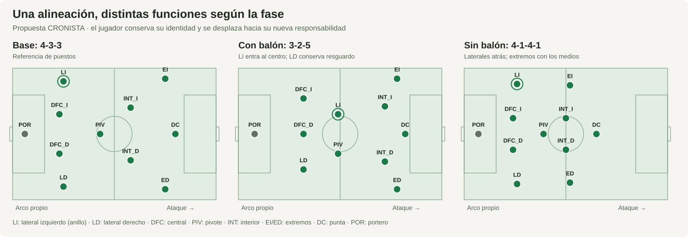

# 033 — Fundamentos de fútbol para formaciones, táctica y movimiento

**Fecha de consulta:** 18 de octubre de 2026.

**Estado:** investigación y propuesta de integración; todavía no implementada.

**Pedido:** dotar a cada equipo de formación y estrategia, ampliar sus variantes y
conseguir desplazamientos colectivos más realistas y fluidos.

La recomendación es representar **jugadores con identidad, puestos, funciones y
decisiones por fase**, manteniendo un estado espacial continuo. Una formación
aporta una distribución de referencia; la táctica determina cómo se modifica ante
el balón, los compañeros, el rival y el estado del partido.

Este documento incluye una base futbolística con fuentes, un catálogo inicial y
una propuesta técnica para CRONISTA. Se acompaña de un
[catálogo JSON propuesto](../tactica/catalogo-propuesto.v1.json), que no consume
todavía la aplicación, y de un [diagrama de las tres estructuras](../tactica/estructuras-433.svg).

## 1. Cómo interpretar la investigación

Se consultaron textos de FIFA Training Centre, UEFA, England Football Learning,
las reglas de IFAB y dos referencias de análisis/animación. Las fuentes están
enlazadas junto a los conceptos y en la bibliografía. Se leyeron las secciones
editoriales pertinentes; no se afirma haber visto los videos adjuntos. Del trabajo
de Müller-Budack y colaboradores se consultó el resumen de los autores.

Se distinguen tres clases de contenido:

| Clase | Qué significa aquí |
| --- | --- |
| Fundamento documentado | Un principio o caso descrito por la fuente enlazada. Puede depender del contexto del ejemplo. |
| Propuesta de CRONISTA | Catálogo, roles operativos, reglas de decisión, coordenadas y arquitectura diseñados para nuestro simulador. |
| Parámetro por calibrar | Una cifra inicial para probar el modelo. No es una medida de tracking ni un estándar FIFA. |

Los casos de equipos reales sirven como referencias de entrenamiento y análisis.
La simulación conserva equipos y jugadores ficticios. No se incorporan sus
plantillas, resultados, videos o trayectorias como datos del partido.

## 2. Lo que permite hoy el sistema y lo que falta

Revisión del código en `683f691`, previa a esta propuesta:

| Componente actual | Comportamiento comprobado en el código | Consecuencia para la integración |
| --- | --- | --- |
| [tipos del simulador](../../src/sim/tipos.ts) | `Posicion` solo distingue `POR`, `DEF`, `MED`, `DEL`; `Estilo` contiene posesión, contragolpe y presión. | Hace falta distinguir lateral, central, pivote, interior, extremo, etc., sin romper el contrato existente. |
| [plantillas](../../src/sim/plantillas.ts) | Los once titulares se generan como un portero, cuatro defensas, tres medios y tres delanteros. | Hoy los equipos parten de un 4-3-3 genérico. Variar el esquema exige asignar puestos y revisar las plantillas. |
| [motor](../../src/sim/motor.ts) | Genera eventos y resultados con probabilidades por estilo, fuerza y contexto; su fatiga depende del minuto. | No existe aún una simulación continua de decisiones y desplazamientos de los 22 jugadores. |
| [microeventos](../../src/sim/micro.ts) | Amplía eventos macro mediante segmentos derivados de su ancla; registra zonas, canales, pases, receptores y distancias. | Es una capa condicionada al macro; no debe presentarse como un motor geométrico que causó ese resultado. |
| [cancha táctica](../../src/vista/tactica.ts) | Distribuye líneas genéricas, ajusta actor/receptor y reconstruye desde zonas; puede reanclar entre acciones. | Las coordenadas no forman todavía una trayectoria continua. Contar `DEF-MED-DEL` no diferencia líneas como el doble pivote y la mediapunta. |
| [reproducción](../../src/vista/reproduccion.ts) | Interpola linealmente antes/después dentro de cada acción, con duración ilustrativa de lectura. | La reproducción mejora la explicación, pero no representa velocidad física ni continuidad entre todas las acciones. |
| [mundo](../../src/mundo/tipos.ts) | Conserva equipos, reservas y configuraciones por partido de temporada. | Es el lugar natural para una identidad táctica persistente, con ajustes por partido. |

**Distinción necesaria:** `condiciones.presion` modela presión contextual del
entorno —incluido el público— y sus efectos en la salida; no es la altura o
intensidad del pressing rival. El nuevo plan debe tener un campo propio, por
ejemplo `presionTactica`. Véanse [condiciones](../../src/sim/condiciones.ts) y
[brief 018](018-condiciones.md).

La integración debe separar dos entregas:

1. **Reconstrucción táctica sobre el legado.** Mantiene los eventos y resultados
   existentes; añade funciones y una representación más coherente cuando sea
   compatible con el registro. Las incompatibilidades siguen identificadas como
   cortes de reconstrucción.
2. **Simulación espacial nueva y versionada.** Las decisiones, trayectorias y
   eventos se generan conjuntamente. Requiere nuevas pruebas y recalibración;
   sus partidos no tienen por qué coincidir con los hashes del motor anterior.

La primera entrega puede aportar valor pronto. La segunda permite que un desmarque,
una cobertura o una mala ocupación del espacio influyan realmente en la jugada.

## 3. Conceptos futbolísticos que debe conocer el modelo

### 3.1 Formación, estructura y función

La formación nominal, como 4-3-3, describe una organización de referencia de los
diez jugadores de campo. Se excluye al portero en esta notación. No identifica por
sí sola la ubicación de cada futbolista durante todo el partido.

UEFA documentó un Inter que partía de 3-5-2, defendía con 5-3-2 y modificaba su
estructura al presionar y construir. También recoge equipos con cinco defensores
sin balón y una ocupación 3-2-5 al atacar. Son casos concretos de adaptación, no
transformaciones obligatorias de esos sistemas. [F01] [F02]

Para CRONISTA conviene separar:

| Concepto | Ejemplo | Permanencia propuesta |
| --- | --- | --- |
| Posición de plantilla | Defensa, medio, delantero | Perfil del jugador; se conserva para compatibilidad. |
| Puesto o slot | Lateral izquierdo, central derecho, pivote | Asignación del plan a un jugador concreto. |
| Función | Dar amplitud, cubrir, ofrecer apoyo, atacar profundidad | Cambia con la fase y la situación. |
| Estructura con balón | 3-2-5 | Referencia colectiva para determinada fase ofensiva. |
| Estructura sin balón | 4-1-4-1 | Referencia para el bloque organizado. |
| Plan estratégico | Circular con apoyos y presionar ante señales | Identidad relativamente estable del equipo. |

Los números 6, 8, 9 y 10 usados en la literatura pueden designar funciones.
**El dorsal no asigna una función:** un jugador con el 23 puede ser el delantero
que inicia el partido; un jugador con el 9 no debe convertirse automáticamente en
delantero por su camiseta.

### 3.2 Fases del juego

FIFA diferencia organización con y sin balón y transiciones tras recuperar o
perderlo. Sus materiales de pressing y contraataque describen respuestas
coordinadas ante esos cambios. [F12] [F13] [F14]

La siguiente máquina de estados es una **simplificación propuesta para CRONISTA**;
no reproduce literalmente toda la taxonomía de FIFA:

| Fase propuesta | Objetivo del equipo | Movimientos que interesa modelar |
| --- | --- | --- |
| Salida con balón | Conectar la primera progresión | Portero disponible, centrales abiertos, apoyos escalonados y una salida segura. |
| Progresión con balón | Superar líneas preservando opciones | Triángulos, recepciones entre líneas, cambios de orientación y avance de apoyos. |
| Último tercio | Crear una ocasión y proteger una pérdida | Amplitud, rupturas, ocupación del área, apoyo atrás y resguardo. |
| Transición tras pérdida | Recuperar o impedir que el rival progrese | Presión cercana si hay cobertura; protección del centro y recuperación de posiciones. |
| Defensa organizada | Proteger espacios peligrosos | Bloque, basculación, presión con cobertura y seguimiento selectivo. |
| Transición tras recuperación | Aprovechar una ventaja o asegurar | Salidas hacia espacio disponible, corredores complementarios y opción de apoyo. |
| Reanudación | Cumplir la colocación y ejecutar el reinicio | Estado específico para saque inicial, córner, falta, etc. |

Una pérdida real puede interrumpir cualquier fase con balón. La transición no
necesita convertirse siempre en un contraataque: si no hay salida viable, el
equipo puede conservar y reorganizarse. Esta elección será una política explícita
del modelo, con condiciones observables.

### 3.3 Espacio: amplitud, profundidad, apoyos y escalonamiento

Ofrecerse no equivale a correr hacia el poseedor: FIFA incluye movimientos para
abrir una recepción, bajar a apoyar y atraer una marca sin terminar recibiendo.
La preparación de una recepción y la elección del ángulo son también centrales en
las sesiones de salida de balón. [F05] [F19]

En el último tercio, las sesiones de FIFA describen el uso de cinco carriles,
combinaciones y acciones exteriores para mover un bloque compacto. [F18] [F20]

**Representación propuesta:** conservar los tres tercios longitudinales actuales
y añadir cinco carriles laterales al modelo espacial:

`banda izquierda | intervalo interior izquierdo | centro | intervalo interior derecho | banda derecha`

Estos carriles son herramientas de ocupación del espacio, no casillas que
prohíban circular por fuera. No deben reutilizarse silenciosamente los tres valores
de `Canal` existentes: hace falta una correspondencia explícita y versionada.

Reglas de diseño derivadas:

- Ofrecer opciones a distinta altura y ángulo; evitar que todos los apoyos queden
  tapados en una misma línea de pase.
- Asignar responsables de amplitud y de profundidad por fase; pueden cambiar de
  jugador mediante una rotación coordinada.
- Reservar una salida atrás cuando sea viable. Un pase hacia atrás puede conservar
  la posesión o preparar el ataque al lado contrario.
- Permitir que un jugador conserve una posición útil. Mantener amplitud o fijar
  un defensor puede ser una acción táctica aunque la ficha apenas se desplace.
- No exigir que los cinco carriles estén ocupados simultáneamente en cualquier
  instante, especialmente durante pérdidas, duelos, repliegues o reanudaciones.

### 3.4 Defender es presionar, cubrir y equilibrar

La organización defensiva de FIFA enfatiza reducir espacios, conservar conexiones
y desplazarse colectivamente. England Football Learning distingue la cobertura
preventiva de la recuperación hacia una posición defensiva después de ser superado.
[F03] [F16]

Para cada situación de presión, el modelo debe identificar responsabilidades
distintas: quién incomoda al poseedor, quién protege la penetración inmediata y
quién conserva el equilibrio respecto a otros rivales. Ser el jugador más cercano
no basta si abandonar su puesto abre una ocasión más peligrosa.

El análisis FIFA del Mundial 2022 usa anchura y longitud del bloque para estudiar
compactación; informa un promedio de bloque medio de aproximadamente 40,1 m de
ancho y 27,2 m de largo. Es una observación de ese torneo y esa fase, no una medida
que todos los equipos deban reproducir. [F04]

**Aplicación propuesta:** medir el tamaño del bloque en cada fase, su desplazamiento
hacia el balón y los huecos que deja. Un bloque compacto puede ceder espacio
exterior; el motor debe representar ese intercambio y la posibilidad del cambio
de orientación rival.

### 3.5 Resguardo ofensivo y salida preparada

FIFA describe el resguardo defensivo como la organización mantenida mientras se
ataca para responder a una pérdida. También analiza una salida ofensiva preparada
mientras se defiende, con responsabilidades diferentes para un atacante. [F15]

En el modelo, **atacar no implica adelantar a todos ni defender implica que todos
retrocedan hasta la misma altura**. Cada perfil asignará candidatos a resguardo y,
cuando corresponda, una salida adelantada. Son responsabilidades dinámicas: un
central puede conducir si otro jugador compensa su avance. No hay una cuota
universal de jugadores de resguardo que resuelva todos los contextos.

## 4. Qué se espera de cada posición y de sus variantes

La tabla sintetiza comportamientos habituales y su traducción al simulador.
La instrucción individual y el contexto pueden modificar cualquiera de ellos.

| Puesto/función | Con balón | Sin balón y en transición | Decisión espacial que debería existir |
| --- | --- | --- | --- |
| Portero | Dar una salida, ajustar el ángulo de apoyo y elegir distribución. | Ajustar profundidad, proteger portería y espacio cercano a la espalda defensiva. | Subir o retroceder según presión, distancia al arco y cobertura. [F06] |
| Central | Ofrecer salida, circular o avanzar si puede hacerlo con apoyo. | Proteger profundidad y área; decidir entre seguir una recepción, sostener línea o cubrir. | No saltar los dos centrales a la misma amenaza sin protección. [F17] |
| Lateral | Dar amplitud, desdoblar o incorporarse por dentro según plan. | Defender su sector y coordinarse con central y jugador exterior. | Elegir recorrido exterior/interior y quién ocupa el espacio que deja. [F07] [F08] |
| Carrilero | Aportar amplitud desde una estructura con tres centrales. | Recuperar su sector y completar la última línea cuando el plan lo pide. | Recorrido longitudinal y coordinación con extremo/interior. [F01] [F02] |
| Pivote | Conectar salida y progresión; ofrecer apoyo con distinta orientación. | Proteger el acceso central y ayudar a cubrir avances. | Escalonarse respecto al poseedor y al otro pivote, si existe. [F05] [F19] |
| Interior/mediocentro | Apoyar, conducir, conectar y llegar a otra altura según reparto. | Mantener conexiones y participar en presión/cobertura. | Alternar apoyo y ruptura sin duplicar la misma carrera del compañero. [F10] [F19] |
| Mediapunta | Ofrecer enlace entre unidades y habilitar a otros atacantes. | Según plan, acompañar al punta en primera presión o cerrar un acceso interior. | Encontrar un bolsillo de recepción o moverse para liberar a otro. [F01] [F05] |
| Extremo/volante exterior | Mantener amplitud o entrar al intervalo si otro compañero ocupa la banda. | Replegar, cerrar por dentro o preparar una salida según instrucción. | Reaccionar al movimiento del lateral y al lugar del balón. [F08] [F11] [F15] |
| Delantero centro | Ofrecer apoyo, fijar, atacar profundidad y temporizar su llegada al área. | Dirigir presión o mantenerse como salida, según plan. | Elegir apoyo/ruptura y sincronizar el movimiento con el posible pase. [F09] [F12] |

Variantes que conviene representar como **funciones**, sin multiplicar
innecesariamente la posición de plantilla:

- Lateral exterior, lateral que entra al centro y lateral conservador.
- Central que sale a anticipar y central que conserva cobertura.
- Pivote de apoyo, pivote de protección e interior de llegada.
- Extremo de amplitud y atacante que ocupa un intervalo interior.
- Delantero de apoyo, delantero de ruptura y delantero que baja a conectar.

Un lateral interior no es necesariamente un futbolista a pierna cambiada. Tampoco
debe narrarse que alguien usa su pierna dominante si esa propiedad no existe en el
registro. El actual `nivel` global no permite deducir velocidad, resistencia o
capacidad de pase por separado: esos atributos requerirían generación sintética
explícita y calibración.

## 5. Catálogo inicial de formaciones y perfiles de equipo

Las siguientes combinaciones son **propuestas de CRONISTA**, inspiradas en los
principios anteriores. No se atribuye a FIFA o UEFA la recomendación de estos siete
perfiles, ni se promete que uno gane a otro.

| Formación base | Composición funcional | Perfil propuesto | Con balón | Sin balón | Principal compromiso |
| --- | --- | --- | --- | --- | --- |
| 4-3-3 | Dos centrales, dos laterales, pivote, dos interiores, dos extremos y punta | Posesión asimétrica | 3-2-5 | 4-1-4-1 | Cubrir el sector del lateral que entra por dentro. |
| 4-2-3-1 | Defensa de cuatro, doble pivote, dos exteriores, mediapunta y punta | Equilibrado | 3-2-4-1 | 4-4-2 | Evitar doble pivote plano y ocupaciones interiores redundantes. |
| 4-4-2 | Dos líneas de cuatro y dos delanteros | Bloque medio compacto | 2-4-4 | 4-4-2 | Resolver una posible inferioridad central sin aislar a los puntas. |
| 4-1-4-1 | Defensa de cuatro, pivote, cuatro medios y punta | Presión con cobertura | 2-3-5 | 4-1-4-1 | Proteger la espalda de la línea alta y gestionar el esfuerzo. |
| 4-1-2-1-2 | Defensa de cuatro, pivote, dos interiores, mediapunta y dos puntas | Rombo central | 2-3-5 | 4-3-1-2 | Obtener amplitud de los laterales y cubrir las bandas. |
| 3-5-2 | Tres centrales, dos carrileros, tres medios y dos puntas | Transición desde bloque bajo | 3-2-3-2 | 5-3-2 | Conectar con los delanteros si los carrileros quedan hundidos. |
| 3-4-3 | Tres centrales, dos carrileros, dos medios y tres atacantes | Amplitud y combinaciones | 3-2-5 | 5-4-1 | Proteger a los dos medios y coordinar carrilero/extremo. |

El JSON contiene la asignación completa de los diez slots en cada estructura, las
preferencias de salida, progresión y pressing, las responsabilidades de resguardo y
los patrones preferidos. Una conversión de fase conserva a las mismas personas;
no añade un mediocampista o un defensor para completar un dibujo.

### 5.1 Cómo cambia realmente el 4-3-3 propuesto

En `posesion-433-asimetrica`, el lateral izquierdo entra junto al pivote; el derecho
se conserva con los centrales. Los extremos mantienen la amplitud, los interiores
ocupan posiciones adelantadas y el punta aporta profundidad. Al organizar la
defensa, los laterales recuperan su línea y los extremos se incorporan a la línea
de medios. El movimiento hacia esas referencias tiene duración y puede ser
interrumpido por la jugada.



El diagrama muestra objetivos de referencia: **no es un saque inicial ni un
registro de movimientos ya producidos**. Las coordenadas exactas del ejemplo
están en `ejemploAnclas` del catálogo y son valores por calibrar.

### 5.2 Cómo generar más opciones

Proponer variantes a partir de restricciones futbolísticas explícitas:

1. Elegir una plantilla válida y asignar una vez a cada jugador activo.
2. Elegir quién proporciona amplitud, apoyo central, profundidad y resguardo.
3. Cambiar una instrucción compatible: reflejar una asimetría, elevar un lateral,
   escalonar un pivote o intercambiar temporalmente funciones vecinas.
4. Verificar cobertura, ocupación y capacidad de los jugadores para ejecutar el
   cambio antes de aceptar la variante.
5. Conservar identidad y posiciones actuales al transitar hacia ella.

Ejemplos de identificadores posibles: `433-lateral-interior-izquierdo-v1`,
`433-lateral-interior-derecho-v1`, `4231-salida-con-tres-v1`.

Una ligera perturbación de coordenadas puede dar variedad de ubicación, pero no
constituye por sí sola una estrategia nueva. La asignación estable de funciones y
sus respuestas debe producir la diferencia visible.

Las estructuras de ataque 2-3-5 o 3-2-5 no se deben convertir automáticamente en
formaciones defensivas de toda la temporada. Las variaciones con menos jugadores
por expulsión se construyen con el número activo real: por ejemplo, un 4-4-1
contiene nueve jugadores de campo y un portero.

## 6. Patrones de movimiento para implementar

Cada patrón necesita **condición de entrada, participantes, intención, cobertura,
duración y condición de abandono**. La tabla es una traducción propuesta; no debe
dispararse completa cada vez que el balón toca una zona.

| ID | Patrón y disparador | Coordinación esperada | Condición para abandonar o no activarlo |
| --- | --- | --- | --- |
| M01 | Apoyo diagonal: poseedor necesita una opción | Un compañero cambia el ángulo; otro puede sostener apoyo atrás. | Nueva línea tapada, distancia inviable o abandono de cobertura crítica. |
| M02 | Pasar y ofrecer otra línea | El pasador busca una nueva recepción dentro de su responsabilidad. | Su permanencia es necesaria para resguardo o la posesión cambia. |
| M03 | Tercer hombre | A conecta con B; C se ofrece en espacio accesible; la continuación depende de la recepción y del rival. | No hay tercer participante disponible o se interrumpe la secuencia. |
| M04 | Desdoblamiento exterior | El jugador exterior entra o atrae; otro llega por fuera; un tercero compensa. | Dos jugadores ocuparían el mismo corredor sin utilidad o falta cobertura. |
| M05 | Desdoblamiento interior | El jugador de banda conserva amplitud y un apoyo ataca por dentro. | El intervalo está cerrado o ya existe un corredor con la misma tarea. |
| M06 | Cambio de orientación | Crear tiempo para el pasador, ofrecer recepción al lado contrario y desplazar apoyos. | No hay línea de pase viable o el receptor no puede llegar. |
| M07 | Ruptura diagonal/curva | Atacante busca espalda o intervalo; el pasador evalúa ventana y sincronización. | Fuera de juego, pase sin ventana o ruptura que ya perdió su ventaja. |
| M08 | Llegada para centro/pase atrás | Repartir zona cercana, alejada y apoyo retrasado entre participantes disponibles. | Pérdida o falta de resguardo; no todos deben entrar al área. |
| M09 | Basculación defensiva | El bloque se acerca al sector del balón conservando conexiones y vigilancia del lado lejano. | El cambio de orientación exige reorganizar; no perseguir el balón en fila. |
| M10 | Presión con cobertura | Un jugador presiona, otro protege penetración y otros cierran opciones relevantes. | El receptor puede superar la presión y no hay protección detrás. |
| M11 | Contrapresión condicionada | Tras una pérdida, los cercanos intentan limitar salidas mientras el resto conserva protección. | Rival supera la primera respuesta, faltan apoyos o se agota la ventana del plan. |
| M12 | Contraataque con corredores complementarios | Tras recuperar, una opción conduce/apoya y otras atacan espacios diferentes. | No existe ventaja accesible: asegurar y reorganizar. |
| M13 | Salida con portero y apoyos | Centrales, portero y medio ofrecen conexiones compatibles con el pressing rival. | Presión elimina la salida corta: evaluar otra ruta o juego directo. |
| M14 | Repliegue y recuperación de conexiones | Recuperar protección de portería y cerrar el acceso central antes de buscar una nueva presión. | El equipo recupera posesión o ya organiza su bloque. |

Fundamento de los patrones: recepción y apoyos [F05]; tercer hombre [F10];
coordinación exterior [F08] [F20]; cambio de orientación [F11]; llegada del punta
[F09]; presión y reacción a pérdida [F12] [F13]; contraataque [F14];
coberturas/repliegue [F16]; salida apoyada [F06] [F19].

Una devolución A→B→A no acredita por sí sola una pared, primer toque o tercer
hombre. Esas etiquetas necesitan la combinación correspondiente y sus movimientos
registrados. El apoyo puede ser útil aunque el jugador no reciba finalmente.

### 6.1 Señales propuestas para el pressing

FIFA describe presión coordinada, trampas, intensidad y adaptación al momento del
partido. También advierte que una presión desorganizada abre espacios. [F12]

La política inicial de CRONISTA podría considerar estas señales **solo si sus datos
existen en el nuevo estado**:

- Recepción cerca de la banda y salidas interiores cubiertas.
- Control largo o balón temporalmente separado del poseedor.
- Pase hacia atrás con tiempo de llegada favorable para el presionante.
- Receptor orientado hacia su portería y apoyo rival limitado.

No basta una etiqueta de `presion`: se evalúan tiempo de llegada, cobertura y
capacidad del rival para progresar. Si orientación corporal o calidad de control
no se han generado, no se usan como causas ni se narran.

## 7. Movimiento continuo: estado, restricciones y tiempos

### 7.1 Mantener el estado de los 22 jugadores

Conservar por jugador una identidad, posición actual, velocidad, puesto e
intención. La siguiente acción parte de ese estado, no de una distribución nueva.
La física conoce posiciones actuales; ninguna decisión consulta el resultado del
siguiente evento para anticipar una interceptación o un gol.


El diagrama corresponde a la **simulación espacial nueva**. El modo de
reconstrucción legado continúa condicionado por los eventos ya generados.

### 7.2 Tres niveles de decisión

La referencia de Reynolds separa estrategia, conducción del movimiento y
locomoción, y presenta aproximación, llegada y evitación de obstáculos. Es útil
para construir animación de personajes; no demuestra por sí misma una táctica de
fútbol. [F24]

Propuesta de aplicación:

1. **Equipo:** decide fase, altura, anchura y responsabilidades.
2. **Jugador:** elige apoyo, presión, cobertura, mantenimiento de posición o carrera
   compatible con su función y con el patrón activo.
3. **Movimiento:** convierte el objetivo en aceleración y desplazamiento con
   límites, llegada gradual y prevención de superposición innecesaria.

El objetivo de un jugador puede combinar ancla por fase, posición del balón,
relaciones con compañeros/rivales y recorrido del patrón. Los pesos varían por
función: un extremo lejano no debe reaccionar exactamente como un pivote cercano.

### 7.3 Integración física propuesta

Para un paso fijo `dt` y objetivo `q`, una aproximación inicial sería:

```text
velocidadDeseada = limitarNorma((q - posicion) / tiempoDeLlegada, velocidadMax)
aceleracion = limitarNorma((velocidadDeseada - velocidad) / tiempoDeAjuste, aceleracionMax)
velocidadSiguiente = limitarNorma(velocidad + aceleracion * dt, velocidadMax)
posicionSiguiente = posicion + velocidadSiguiente * dt
```

Todos los tiempos y límites deben ser positivos y finitos. La llegada desacelera;
el último ajuste de posición debe respetar una tolerancia pequeña y no esconder
un salto grande. Al cambiar de fase se conserva posición y velocidad.

El catálogo incluye valores de arranque para **calibración sintética**: paso de
0,1 s; bandas de marcha 1–2 m/s, apoyo 2–4, carrera 4–6 y sprint 6–8,5; aceleración
máxima de 3 m/s² y tolerancia de llegada de 0,25 m. No son valores universales de
futbolistas ni provienen de una muestra de tracking. Deben ajustarse a duración,
perfil, esfuerzo y calidad visual, y centralizarse al implementarlos.

Separación y evitación son criterios suaves para no apilar fichas. No pueden
prohibir cualquier cercanía entre rivales: el fútbol incluye marcaje, disputa,
contacto y faltas. Una curva decorativa tampoco debe atravesar jugadores o
salirse del terreno inadvertidamente.

### 7.4 Balón, receptor y distancias

- El pase necesita origen, instante de golpeo, destino o punto de interceptación
  y tiempo de viaje. El receptor se mueve desde su posición actual.
- Comparar llegadas de receptor y defensor. El éxito no se decide por el color
  de una línea dibujada: debe corresponder al evento generado.
- Un pase fallado no termina automáticamente en los pies del receptor previsto.
  El balón pasa a una interceptación, balón dividido o salida registrada.
- La conducción mantiene relación espacial entre actor y balón; nadie adquiere
  la posesión desde otro extremo de la cancha.
- En legado se preservan `distanciaM` y sus contratos. Si una curva aumenta la
  distancia recorrida, no puede mantenerse una narración que diga que recorrió
  una longitud distinta: limitar la curva o calcular su longitud compatible.
- La nueva versión debe definir si una magnitud mide desplazamiento, longitud de
  recorrido o distancia al arco, con unidades y redondeo explícitos.

### 7.5 Tiempo del modelo y tiempo de lectura

Separar tres relojes:

| Reloj | Uso |
| --- | --- |
| Minuto registrado | Lo que conoce hoy el partido legado. No aporta segundos exactos. |
| Tiempo sintético de simulación | Duración generada y consistente de carreras, pases y decisiones en la nueva versión. |
| Tiempo de reproducción | Ritmo de lectura y velocidad elegida por el usuario. Puede acelerar o pausar la escena. |

El ritmo visual no debe limitar la rapidez física del futbolista. Para hacer la
lectura más lenta, se escala la reproducción del estado ya calculado. El movimiento
reducido usa estados discretos de esa misma secuencia.

Generar a paso fijo y renderizar mediante interpolación evita que la simulación
dependa de los FPS. Guardar checkpoints y reconstruir tramos al buscar una acción
permite controlar memoria; no hace falta enviar al cliente cada fotograma de los
90 minutos. La geometría autoritativa se calcula una sola vez por versión y semilla.

### 7.6 Si el registro legado hace imposible una transición

El constructor actual puede reanclar entre zonas y sus eventos no contienen
tiempos suficientes para resolver cada desplazamiento. Por tanto:

- No modificar el resultado, los metros o los jugadores del registro para que
  encajen en un dibujo táctico.
- Registrar una incompatibilidad espacial y mostrar un corte de reconstrucción
  cuando no existe una transición defendible con los datos disponibles.
- No mostrar una carrera físicamente imposible con apariencia de tracking.
- No usar un pase o tiro futuro para mover a un jugador antes de que ese dato
  corresponda al prefijo mostrado.

La continuidad completa debe exigirse al nuevo motor espacial. En la reconstrucción
del legado se mide y declara cuántos cortes siguen siendo necesarios.

## 8. Reglas del juego y situaciones que cambian la estructura

### 8.1 Jugadores, cambios y expulsiones

IFAB establece un máximo de once jugadores por equipo, incluido un portero, y un
mínimo reglamentario de siete con las salvedades de sus protocolos. Un jugador
expulsado después del inicio no puede ser reemplazado. [F21]

En CRONISTA:

- El jugador sustituido abandona el estado activo; entra el suplente con identidad
  propia y una asignación explícita de puesto.
- Una expulsión reduce la cantidad de slots. La reorganización puede sacrificar
  amplitud, una salida o un atacante; no crea un reemplazo invisible.
- Si cambia el portero, la función se registra expresamente, no se infiere del dorsal.
- La versión nueva necesita gestionar el caso de quedar por debajo del mínimo
  reglamentario, en lugar de seguir completando una formación ficticia.

El código actual limita a **tres cambios y cinco suplentes**. Es una simplificación
del proyecto. IFAB permite en competiciones oficiales hasta cinco sustituciones
según sus reglas de competición y distingue las oportunidades para realizarlas.
Debe parametrizarse esa política en una ampliación versionada; este documento no
cambia el comportamiento legado. [F21]

### 8.2 Fuera de juego

La referencia es el balón y el **penúltimo adversario**, no simplemente el último
defensa. Se evalúa la posición en el toque pertinente de un compañero y hace falta
intervención activa para sancionar; estar adelantado por sí solo no es infracción.
No hay infracción al recibir directamente de saque de meta, banda o esquina.
IFAB también distingue juego deliberado, rebote y salvada. [F23]

El motor puede usar puntos representativos de jugadores como aproximación
declarada, pero no atribuir precisión de VAR a sus bolitas. Las carreras se
sincronizan con el golpeo. El modelo debe permitir un atacante temporalmente en
posición adelantada que no participa; no debe arrastrarlo siempre detrás de la línea.

### 8.3 Saque inicial y otras reanudaciones

Para el saque inicial, IFAB exige el balón en el centro, adversarios a al menos
9,15 m y jugadores en su propio campo, salvo el ejecutor. El balón puede ponerse
en juego con un pase hacia atrás. Los equipos cambian de campo al segundo tiempo.
[F22]

La colocación nominal de ataque no se usa como ubicación de saque. Es necesaria
una política específica de reinicio que, al ejecutarse, dé paso al movimiento en
juego abierto. Córneres, faltas, penales y saques de banda/meta necesitan sus
propias restricciones antes de ser parte del motor espacial; no se resuelven
copiando la estructura de posesión.

El legado no siempre identifica al ejecutor del saque de centro. La narración
actual no debe inventarlo. La nueva versión podrá identificarlo si genera y guarda
esa acción expresamente.

## 9. Dar a cada equipo una identidad y permitir adaptación

### 9.1 Identidad persistente

Asignar a cada equipo ficticio un `planBase` estable por versión y temporada.
Seleccionar entre perfiles compatibles con sus jugadores y guardar el resultado;
no sortear una táctica independiente en cada fotograma o visita de página.

Propuesta de clave determinista:

```text
prngDerivado(semillaMundo, "tactica:v1:equipo:" + equipoId + ":temporada:" + temporada)
```

La identidad estable de equipo y jugador debe ser explícita en la nueva versión.
El nombre y el orden de un array no deben convertirse en la única identidad del
nuevo motor. El legado puede seguir usando sus identificadores actuales mediante
un adaptador, sin renombrar eventos publicados.

El estilo actual es una preferencia inicial. `posesion` puede originar 4-3-3,
4-2-3-1 o rombo, por ejemplo; no determina una formación obligatoria. La política
debe considerar puestos disponibles, reservas y capacidades generadas.

### 9.2 Ajustes contextuales propuestos

| Contexto ya observado | Ajuste candidato | Requisito para ejecutarlo |
| --- | --- | --- |
| Rival cierra el centro | Más circulación exterior o cambio de orientación | Amplitud, receptor y cobertura disponibles. |
| Rival presiona salida corta | Apoyo extra o distribución más directa | Ruta viable y compañeros preparados para disputar/recibir. |
| Equipo necesita un gol al final | Mayor ocupación ofensiva o cambio de plan | Jugadores compatibles y riesgo aceptado por su política. |
| Equipo protege una ventaja | Menor exposición y apoyos de conservación | Preservar alguna salida; no replegar automáticamente a todos. |
| Pérdidas repetidas en un sector | Cambiar apoyo, alturas o ruta | Usar una ventana de acciones pasadas; no el resultado final. |
| Expulsión o sustitución | Reasignar puestos activos | Misma identidad para quienes siguen y desplazamiento continuo. |
| Esfuerzo acumulado alto | Menos presión continua o redistribución de carreras | Contador de esfuerzo real del nuevo modelo, no suposición del narrador. |

Las señales tácticas y su respuesta son propuestas de implementación. No hay
evidencia en esta investigación de una regla universal «cambiar al minuto 65» ni de
que todo equipo deba contrapresionar una cantidad fija de segundos.

Para evitar cambios constantes, el catálogo propone inicialmente una ventana de
contrapresión de 3–5 s, una persistencia orientativa de estado de 2 s y un intervalo
de 10 minutos entre cambios voluntarios de plan. **Son parámetros de prueba**:
una pérdida efectiva, reanudación o expulsión puede interrumpir el estado; ese
intervalo no impide reaccionar al juego ni cambiar funciones dentro del mismo plan.

## 10. Contratos de datos propuestos

Los siguientes tipos describen una dirección de diseño; no son tipos ya existentes
ni una migración que se pueda activar sin actualizar los contratos afectados.

```ts
interface PlanTacticoPropuesto {
  version: "tactica-v1";
  perfilId: string;
  formacionBase: string;
  // Incluye al portero y una sola asignación por jugador activo.
  asignacion: Record<string, string>; // slotId -> jugadorId
  estructuras: Record<string, string[][]>; // fase -> líneas de slots
  instrucciones: Record<string, string[]>;
}

interface EstadoJugadorEspacialPropuesto {
  jugadorId: string;
  slotId: string;
  posicion: { x: number; y: number }; // metros en la cancha
  velocidad: { x: number; y: number }; // m/s del modelo
  intencionId?: string;
  activo: boolean;
}

interface RegistroTacticoPropuesto {
  id: string;
  version: "tactica-v1";
  origen: "simulacion-espacial" | "reconstruccion-condicionada";
  desdeOrden: number; // inicio de visibilidad causal
  hastaOrden?: number;
  tiempoSimS?: number; // solo si se ha generado explícitamente
  lado: "local" | "visita";
  patronId?: string;
  jugadores: string[];
  accionCausalId: string;
  motivo: string; // código de razón estructurado, no prosa inventada
  estado: "intentado" | "en_curso" | "completado" | "abandonado";
}
```

En la nueva versión, el estado del partido incluye ambos planes, las fases, el
balón, el control de posesión, los jugadores activos y las intenciones. El registro
de movimientos puede enlazar waypoints o checkpoints sin repetirlos en cada frase.

Coordenadas del catálogo: `u=0` en arco propio y `u=1` en el rival; `v=0` a la
izquierda desde quien ataca. Convertir a los 105×68 m actuales y aplicar
`orientar()` según lado y periodo, incluido el eje lateral. Nunca invertir el
segundo tiempo dos veces entre la capa táctica y el renderer.

### 10.1 Resolver las decisiones

Propuesta de evaluación por jugador:

```text
candidatos = acciones_permitidas_por_funcion_y_fase(estado_actual)
para cada candidato:
    descartar si incumple identidad, jugadores activos o reglas de reinicio
    evaluar progreso, recepción viable, apoyo, cobertura y coste de desplazamiento
elegir usando prioridades del plan y desempate determinista
coordinar intenciones incompatibles entre compañeros
avanzar el estado espacial
resolver la acción y registrar el resultado que realmente ocurrió
```

Un índice geométrico de seguridad o una puntuación táctica no debe presentarse
como porcentaje de éxito empírico sin calibración. Tampoco una táctica puede
garantizar una recuperación por activar M10. El rival mantiene sus propias
decisiones y puede superar la presión.

Los efectos de estilo que ya cambian probabilidades no se deben volver a sumar
sin control cuando el nuevo modelo incluya geometría. Hay que revisar su
calibración conjunta, incluidas las condiciones y el nivel, evitando contabilizar
dos veces una misma ventaja.

## 11. Narración derivada de lo que ocurrió

El modelo conserva separado **lo que se intentó** de **lo que se consiguió**.
Proporcionar amplitud no acredita recibir libre; correr hacia el área no acredita
haber arrastrado a un defensor. Una causa narrativa debe tener condición o evento
que la respalde.

| Frase candidata | Evidencia mínima propuesta |
| --- | --- |
| «Abre una línea de pase» | Cambio de posición y mejora registrada de la accesibilidad de ese pase. |
| «Se ofrece por detrás» | Intención de apoyo y posición relativa verificable. |
| «Arrastra al central» | Carrera y respuesta efectiva del central; no basta el movimiento atacante. |
| «Deja pasar al lateral por fuera» | Trayectoria exterior del lateral y ocupación coordinada del compañero. |
| «Presionan y obligan a jugar atrás» | Presión registrada y resultado posterior compatible; distinguir causalidad modelada de simple sucesión. |
| «Mantiene la amplitud» | Función activa y posición conservada en el sector durante la ventana considerada. |
| «Cubre la subida» | Responsabilidad y ocupación efectiva del espacio vulnerable. |

El relato fluido selecciona movimientos significativos. El registro detallado
puede enumerar todas las intenciones y trayectorias relevantes mediante IDs. No
es necesario narrar a los 22 jugadores en cada paso de 0,1 s para conservar la
evidencia del partido completo.

Las plantillas deterministas y el Writer deben consumir el mismo registro
estructurado que usa la cancha. El Verificador V1–V8 actual **no prueba estas
nuevas afirmaciones geométricas o causales**: se necesitarán comprobaciones
específicas antes de publicarlas como verificadas.

### 11.1 Ejemplo sintético de salida y avance

**Ejemplo inventado para diseñar el motor nuevo. No describe un partido actual ni
uno de los transcripts.** El equipo ataca hacia `x` creciente. El saque inicial
parte de una colocación válida; las acciones posteriores ocurren en juego abierto.

| Orden | Acción registrada propuesta | Origen → destino | Distancia |
| --- | --- | --- | --- |
| 1 | Juan, dorsal 23, ejecuta hacia Esteban, dorsal 8 | (52,5; 34) → (45,5; 34) | Pase de 7 m hacia atrás |
| 2 | Esteban conduce y cruza la mitad | (45,5; 34) → (55,5; 34) | Conducción de 10 m |
| 3 | Esteban pasa a Camilo, dorsal 10 | (55,5; 34) → (67,5; 18) | Pase diagonal de 20 m |
| 4 | Camilo avanza con el balón | (67,5; 18) → (70,5; 18) | Conducción de 3 m |
| 5 | Camilo conecta con el extremo de dorsal 11 | (70,5; 18) → (75,5; 6) | Pase de 13 m hacia la banda izquierda |

Las distancias del ejemplo coinciden con su geometría. En los golpes de pase se
supone registrado un penúltimo rival a `x=80`, por lo que estos receptores no
arrancan adelantados a esa referencia. Los movimientos sin balón también deben
tener sus registros: el lateral izquierdo ofrece apoyo interior, el derecho
conserva resguardo y el extremo mantiene una opción exterior.

Narración posible, si esos registros se producen:

> Inicia el encuentro. Juan, con el 23, pone el balón siete metros hacia atrás para
> Esteban. El ocho conduce diez metros y cruza la mitad de la cancha. El lateral
> izquierdo se ofrece por dentro y el extremo conserva la amplitud. Esteban juega
> en diagonal hacia Camilo, que recibe en el sector interior izquierdo. El diez
> avanza tres metros y conecta con el extremo abierto en la banda. Por detrás,
> los centrales y el lateral derecho mantienen la cobertura.

La frase sobre la cobertura requiere comprobarla en las posiciones de ese
instante. El texto no debe afirmar que el rival queda superado, que hubo primer
toque o que existe una ocasión de gol si esos resultados no se generaron.

## 12. Integración propuesta en el repositorio

### Etapa A — Perfil y reconstrucción táctica compatible

**Primer alcance recomendado:** 4-3-3, 4-2-3-1 y 4-4-2; siete perfiles quedan
documentados para ampliar después. Implementar slots y asignación persistente,
fase con/sin balón, apoyo, amplitud, cobertura y basculación.

Archivos candidatos nuevos, todavía inexistentes:

```text
src/tactica/tipos.ts           # planes, puestos, fases, intenciones y procedencia
src/tactica/catalogo.ts        # catálogo validado convertido desde la propuesta
src/tactica/asignacion.ts      # jugador -> slot, sustituciones y variantes
src/tactica/contexto.ts        # estado permitido por el prefijo mostrado
src/tactica/reconstruccion.ts  # encaje con eventos legado y cortes explícitos
```

Puntos de conexión: `src/mundo/tipos.ts`, `src/vista/tactica.ts`,
`src/ui/Formaciones.tsx`, `src/vista/relato.ts` y la reproducción existente.
Mostrar por separado formación nominal, estructura modelada de la fase y
alineación activa cuando esos conceptos difieran.

No convertir todos los `DEF` en laterales/centrales por orden cada vez que se
expulsa a alguien. Crear una asignación estable. Si un `DEL` legado se usa como
volante en una reconstrucción, conservar su posición de plantilla y declarar la
función modelada; cambiar la etiqueta no demuestra una nueva alineación real.

### Etapa B — Simulación espacial y eventos conjuntos

Añadir estado continuo, locomoción, balón, decisiones y registro de movimientos.
La geometría debe participar en los pases, duelos y carreras; los patrones se
interrumpen ante las decisiones del rival. Extender el registro con versión propia,
sin renumerar silenciosamente los eventos históricos.

```text
src/tactica/movimiento.ts      # paso fijo, velocidad, aceleración y llegada
src/tactica/decisiones.ts      # candidatos y coordinación causal
src/tactica/patrones.ts        # M01–M14 con entrada, salida y roles
src/tactica/registro.ts        # movimientos y resultados citables
```

Esto afecta `src/sim/motor.ts`, `src/sim/micro.ts`, sus contratos y el dataset.
Una variante o versión ausente debe conservar el partido antiguo byte a byte.
Con la nueva versión activada, regenerar evidencia, estadísticas y evaluación;
no trasladar automáticamente los resultados de la evaluación histórica.

### Etapa C — Adaptación y ampliación

Incorporar los otros perfiles, reorganización por expulsiones, cambios voluntarios
de plan, atributos específicos, esfuerzo acumulado y reanudaciones más completas.
Las afirmaciones nuevas del relato requieren chequeos de geometría y causalidad,
y una evaluación humana independiente de plausibilidad.

El LLM puede redactar a partir de registros ya producidos. No necesita decidir
coordenadas en cada fotograma ni completar movimientos ausentes mediante prosa.

## 13. Qué comprobar antes de llamar realista a la integración

Esta entrega documental permite verificar la coherencia del catálogo. Las pruebas
de comportamiento siguientes son criterios para la implementación futura.

| Área | Criterio de aceptación propuesto |
| --- | --- |
| Identidad y cantidad | Cada jugador activo ocupa un único slot; el portero existe; sustituciones y expulsiones no duplican personas. |
| Conservación de funciones | Las transformaciones de fase contienen exactamente los mismos slots; intercambiar puestos no cambia identidades. |
| Determinismo | Misma semilla, versión y entrada producen el mismo resultado; renderizar a otra frecuencia no consume otro azar. |
| Prefijo causal | Extender el partido con acciones futuras no altera posiciones, intenciones ni texto ya visibles. |
| Continuidad | En modo nuevo, el estado final de un paso coincide con el inicial del siguiente, excepto entradas/salidas o reinicios declarados. |
| Física | Desplazamiento compatible con tiempo, velocidad y aceleración; unidades y tolerancias documentadas. |
| Pase y posesión | Recepción e interceptación accesibles; continuidad del poseedor; pase fallado sin recepción atribuida al destinatario previsto. |
| Organización colectiva | Anchura, longitud y distancias entre líneas varían con fase y contexto; medir frecuencia de apelotonamiento y huecos. |
| Complementariedad | Una subida o salto tiene compensación si el plan la exige; no todos ejecutan el mismo movimiento al balón. |
| Reglas | Colocación de saque, fuera de juego aproximado y cantidad activa comprobados en sus instantes pertinentes. |
| Narración | Toda afirmación espacial enlaza con el registro que la acredita; intención y resultado permanecen separados. |
| Legado | Con variante ausente se preservan hashes y datos anteriores; contabilizar cortes de reconstrucción sin ocultarlos. |
| Rendimiento | Medir CPU, memoria, tamaño de checkpoints y búsqueda de acciones en escritorio/móvil antes de fijar presupuesto. |
| Usabilidad | Controles, selección de frase, velocidad, pausa y movimiento reducido usan la misma secuencia. |

Escenarios prioritarios: salida corta contra presión; circulación frente a bloque
bajo; cambio de orientación; desdoblamiento con cobertura; pérdida con y sin
apoyos; rival que supera la contrapresión; fuera de juego; cambio de lado en 2T;
sustitución; roja a lateral/central/pivote/portero; protección de ventaja y búsqueda
de empate sin consultar el futuro.

La comparación con la versión actual debe usar las mismas semillas cuando sea
pertinente, pero no exigir los mismos resultados al motor nuevo. Medir cortes por
100 acciones, inconsistencias de recepción y cobertura, diferencias entre perfiles
y valoración humana de comprensión/credibilidad. Una animación más suave y unas
invariantes aprobadas no prueban por sí mismas fidelidad a fútbol profesional.

Los umbrales futuros deben centralizarse conforme a las reglas del repositorio:
dominios/bandas en `src/sim/limites.ts` y parámetros de generación en la capa
correspondiente; ninguna prueba debe mantener su propia copia de esas cifras.

### 13.1 Verificación de esta entrega documental

El [validador del catálogo](../tactica/validar-propuesta.mjs) comprueba trece
invariantes estructurales: cantidad e identidad de puestos, conservación entre
fases, funciones válidas, patrones documentados, coordenadas, distancias del
ejemplo, referencias y enlaces locales. Se ejecuta desde la raíz:

```bash
node docs/tactica/validar-propuesta.mjs
```

La [evidencia de ejecución](../evidencia/validacion-propuesta-tactica.json) incluye
los resultados y hashes de los archivos. El diagrama también se renderizó y
revisó visualmente. Estos controles no acreditan realismo futbolístico ni
calibración física; el código de la aplicación no cambió en esta entrega.

## 14. Bibliografía y alcance de cada fuente

Consulta web del **18 de octubre de 2026**. Todos los enlaces llevan a la fuente
primaria, no al buscador. Las páginas `/latest/` de IFAB mostraban la edición
2026/27; al implementar reglas conviene fijar también la edición de competición.
Las propuestas del catálogo no son una transcripción de los esquemas de estas
fuentes.

| ID | Fuente | Aporte usado y límite |
| --- | --- | --- |
| [F01] | UEFA, *In the Zone: Milan 0–2 Inter performance analysis* | Caso de distintas estructuras en inicio, defensa, salida y presión. No receta universal. |
| [F02] | UEFA, *Three at the back and what it meant for No9s at EURO 2020* | Relación entre defensa de tres/cinco y ocupación ofensiva. Contexto de ese torneo. |
| [F03] | FIFA, *Team organisation out of possession* | Organización, compactación y desplazamiento colectivo defensivo. |
| [F04] | FIFA, *The mid-block and compactness* | Definición y métricas de bloque medio; muestra del Mundial 2022, no objetivo normativo. |
| [F05] | FIFA Football Language, *Offering to receive* | Ofrecerse, generar recepción y movimientos que pueden no acabar en recepción. |
| [F06] | FIFA / Dean Santangelo, *Goalkeeper’s build-up* | Apoyo del portero y ajuste de posición entre fases. |
| [F07] | FIFA, *Innovation: The emerging positioning of the inverted full-back* | Diferentes maneras de interiorizar laterales; observaciones del Mundial de Clubes 2025. |
| [F08] | FIFA, Francia sub-17, *Using the full-backs to create and finish* | Coordinación entre lateral, extremo, medio y llegadas al área. Sesión de entrenamiento. |
| [F09] | FIFA, *Centre-forwards heading attacks* | Sincronización, ocupación y movimientos para crear/atacar espacio. |
| [F10] | FIFA, *Third-player combinations* | Secuencia coordinada con un tercer participante. |
| [F11] | FIFA, *Switch of play* | Preparación del pasador, receptor y apoyos al cambiar de lado. |
| [F12] | FIFA, *High press* | Organización, señales e intensidad; riesgo de presión descoordinada. |
| [F13] | FIFA, *The reaction to losing the ball* | Respuestas individuales y colectivas tras pérdida. |
| [F14] | FIFA, *The counter-attack* | Recuperación, progresión y carreras coordinadas en transición. |
| [F15] | FIFA, *France: Rest attack enhances counter-attacking efficiency* | Resguardo y salida preparada; caso de Francia analizado en mayo de 2026. |
| [F16] | England Football Learning, *What is covering and recovering?* | Diferencia entre cubrir y recuperar posición defensiva. |
| [F17] | The FA, *Centre backs stepping out to defend in midfield areas* | Beneficios y exposición cuando un central abandona su línea para presionar. |
| [F18] | FIFA / Aidy Boothroyd, *Breaking down a low block* | Uso de carriles, desequilibrio, combinaciones y espacios frente a bloque bajo. |
| [F19] | FIFA / Rehanne Skinner, *Building from the back* | Ángulos de apoyo, medios y laterales ante distintas presiones. |
| [F20] | FIFA / Daniel Gygax, *Attacking in wide areas* | Coordinación exterior, centros y pases atrás. |
| [F21] | IFAB, Regla 3: jugadores | Cantidad, portero, sustituciones y expulsiones; remitirse a política de competición. |
| [F22] | IFAB, Regla 8: inicio y reanudación | Saque inicial y cambio de campo; no cubre aquí todas las otras reanudaciones. |
| [F23] | IFAB, Regla 11: fuera de juego | Referencias, instante, participación y excepciones; simplificación geométrica debe declararse. |
| [F24] | Craig Reynolds, *Steering Behaviors for Autonomous Characters*, GDC 1999 | Arquitectura de movimiento/animación; no estudio de táctica futbolística. |
| [F25] | Müller-Budack et al., *Does 4-4-2 exist?*, 2019 | Resumen de autores sobre formación según situación/posesión y límites de etiquetas; no se replica su clasificador. |

El trabajo [F25] refuerza la conveniencia de mirar situaciones y segmentos además
de una etiqueta nominal. No se deduce de él que nuestro catálogo, nuestro solver
o unas coordenadas concretas estén validados científicamente.

[F01]: https://www.uefa.com/uefachampionsleague/news/0281-17ff4a6e4c6a-015779381253-1000--analysis-inter-outrun-milan/
[F02]: https://www.uefa.com/uefaeuro/history/news/026e-1379b5a2c19e-b6c8e52830da-1000--three-at-the-back-and-what-it-meant-for-no9s-at-euro-2020/
[F03]: https://www.fifatrainingcentre.com/en/game/game-analysis/out-of-possession/team-organisation--out-of-possession-.php
[F04]: https://www.fifatrainingcentre.com/en/fwc2022/technical-and-tactical-analysis/controlling-the-game-without-the-ball--the-mid-block-and-compactness.php
[F05]: https://www.fifatrainingcentre.com/en/resources-tools/football-language/in-possession/offering-to-receive/index.php
[F06]: https://www.fifatrainingcentre.com/en/practice/elite-sessions/goalkeeper/goalkeepersbuildup.php
[F07]: https://www.fifatrainingcentre.com/en/game/tournaments/fcwc/2025/team-analyses/emerging-positioning-of-the-inverted-full-back.php
[F08]: https://www.fifatrainingcentre.com/en/practice/elite-sessions/youth-national-teams/france-u17-men/thursday-session.php
[F09]: https://www.fifatrainingcentre.com/en/game/tournaments/2023-u20-fwc/centre-forwards-heading-attacks.php
[F10]: https://www.fifatrainingcentre.com/en/game/game-analysis/in-possession/third-player-combinations.php
[F11]: https://www.fifatrainingcentre.com/en/game/game-analysis/in-possession/switch-of-play.php
[F12]: https://www.fifatrainingcentre.com/en/game/game-analysis/out-of-possession/high-press.php
[F13]: https://www.fifatrainingcentre.com/en/game/game-analysis/transition-to-defending/the-reaction-to-losing-the-ball.php
[F14]: https://www.fifatrainingcentre.com/en/game/game-analysis/transition-to-attacking/the-counter-attack.php
[F15]: https://www.fifatrainingcentre.com/en/game/game-analysis/world-class-tactics/france-rest-attack-enhances-counter-attacking-efficiency.php
[F16]: https://learn.englandfootball.com/articles-and-resources/coaching/resources/2023/What-is-covering-and-recovering
[F17]: https://community.thefa.com/coaching/b/insights-analysis-blogs/posts/centre-backs-stepping-out-to-defend-in-midfield-areas
[F18]: https://www.fifatrainingcentre.com/en/practice/elite-sessions/in-possession/boothroyd-breaking-down-a-low-block.php
[F19]: https://www.fifatrainingcentre.com/en/practice/elite-sessions/in-possession/building_from_the_back_skinner.php
[F20]: https://www.fifatrainingcentre.com/en/practice/elite-sessions/in-possession/gygax-attacking-in-wide-areas.php
[F21]: https://www.theifab.com/laws/latest/the-players/
[F22]: https://www.theifab.com/laws/latest/the-start-and-restart-of-play/
[F23]: https://www.theifab.com/laws/latest/offside/
[F24]: https://www.red3d.com/cwr/steer/
[F25]: https://arxiv.org/abs/1910.00412
